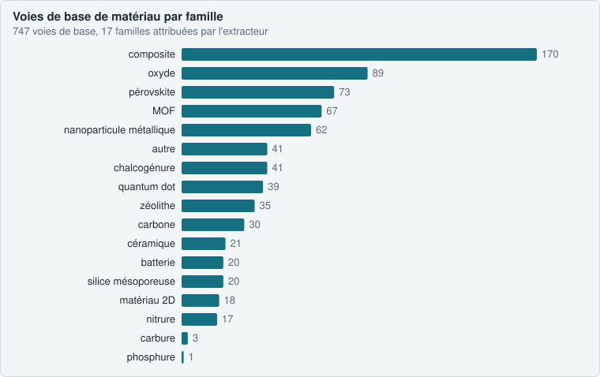
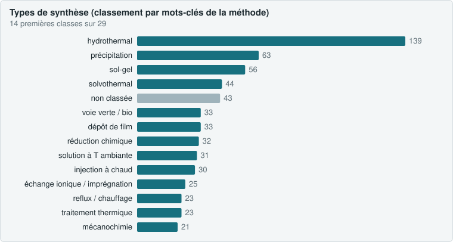
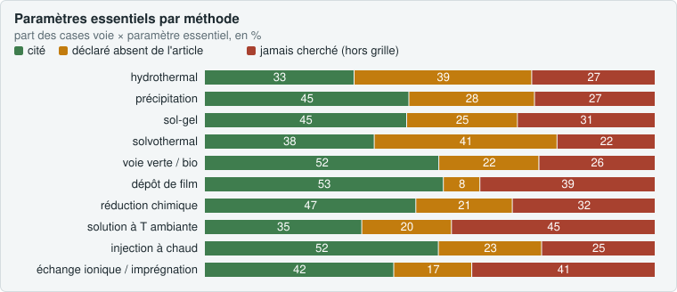
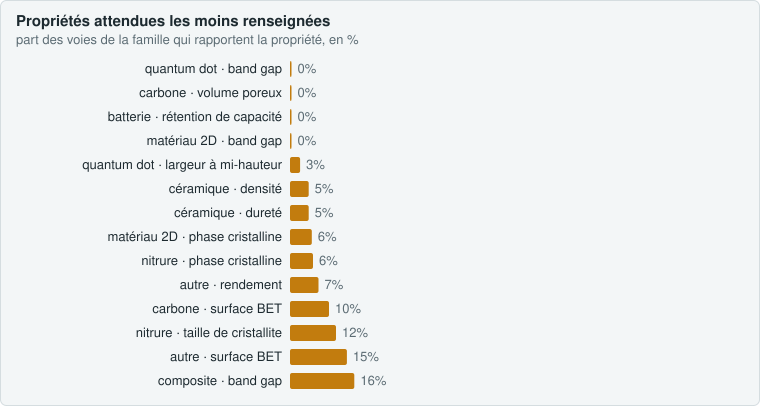
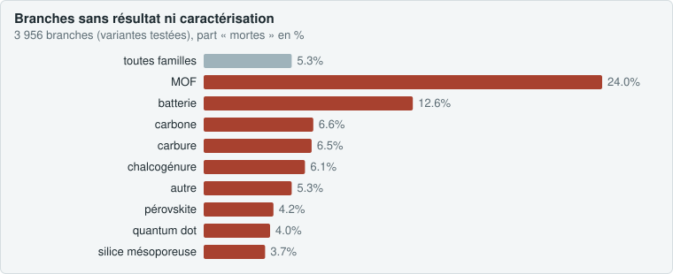
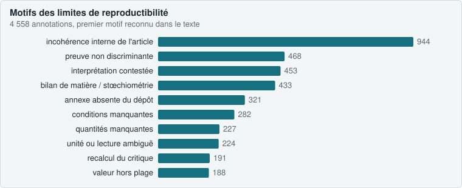
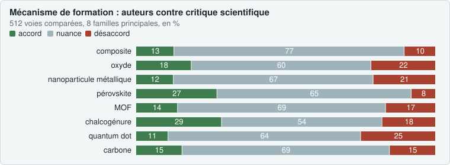
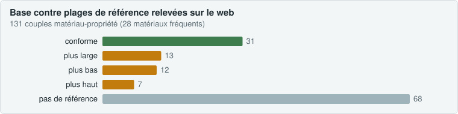
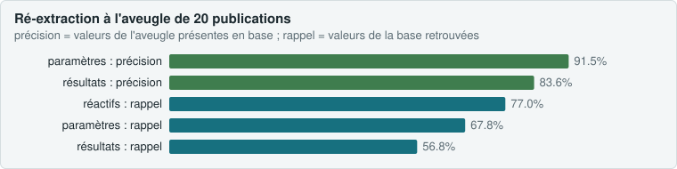

<p align="center"><a href="README.md">English</a> · <b>Français</b> · <a href="#résumé">Présentation</a> · <a href="#analysis">Analyse</a> · <a href="https://terrychauvin.github.io/synthgraph-multi-agent-cloud/#fr-presentation">Site interactif (onglets FR/EN)</a></p>

# Base de voies de synthèse de matériaux — méthodologie d'extraction et de vérification par pipeline multi-agent

`synthese.db` (SQLite) rassemble des voies de synthèse de matériaux extraites d'articles en accès libre, où **chaque valeur porte la citation mot pour mot de l'article** qui la fonde, sa position dans le texte, et l'état de ce que l'article ne dit pas. Ce document décrit, à la manière d'une section « Matériel et méthodes », comment la base est construite, comment chaque valeur est vérifiée, ce que les contrôles mesurent, et dans quel sens, scientifiquement, on peut considérer son contenu comme juste.

État au 28 octobre 2026 : **500 publications closes et auditées** (dix paliers de 50, cible atteinte), 5 338 voies (1 382 voies de base, 3 956 branches), 39 350 résultats mesurés (`synthese.db`, requêtes en lecture seule) ; 95 053 citations vérifiées mot pour mot (100 %) sur les dix paliers ; rapports `audits/palier_00N_relecture.md` (N = 1 à 10) et `audits/palier_010_relecture.md` pour le dernier. Les mesures détaillées des sections 6.1 à 6.2 portent sur les paliers 1 à 4 ; les paliers 5 à 10 sont résumés en 6.3 et 6.4. Deux audits postérieurs à la cible décrivent le contenu (`audits/audit_contenu.md`) et vérifient la base (`audits/audit_verification.md`) : voir la section « Analyse de la base » ci-dessous.

---

## Résumé

**Objectif.** Permettre à un chimiste de refaire un matériau à partir de la base seule, et de voir comment chaque variation de synthèse testée par les auteurs change le résultat.

**Méthode.** Un corpus d'articles ouverts (Europe PMC, licences Creative Commons) est transformé en voies de synthèse structurées par un pipeline de cinq passes exécutées par des agents de langage à rôles séparés : extraction, contrôle automatique et chargement, critique de fidélité par un second lecteur indépendant, critique scientifique sourcée, application des corrections. Tous les 50 articles, un audit recontrôle chaque citation, applique des tests physico-chimiques, relit à la main un échantillon de valeurs, recalcule la stœchiométrie de cinq voies, compare les synthèses d'un même matériau entre publications et vérifie des sources citées.

**Principes.** Aucune valeur sans citation exacte ; rien d'inventé, déduit ou converti à la place des auteurs ; toutes les variations comparées par les auteurs capturées, y compris les échecs ; les incohérences des auteurs conservées et signalées, jamais réparées ; les interprétations séparées des données ; une erreur vue deux fois devient une règle écrite.

**Résultats.** Sur 200 publications : 100 % des 37 478 citations retrouvées mot pour mot dans les textes ; 42 publications relues valeur par valeur (3 593 valeurs, 10 erreurs, toutes dans les 10 premières publications de calibrage ; 1 erreur sur 3 032 valeurs ensuite, soit 0,03 %, borne supérieure à 95 % ≈ 0,16 %) ; 1 770 constats du critique de fidélité dont 48 « faux », aucun d'eux n'étant, depuis le palier 2, un nombre mal recopié du texte ; 1 166 voies jugées par la critique scientifique (434 cohérentes, 604 douteuses, 46 incohérentes, 82 invérifiables), les problèmes venant des articles et non des extractions.

**Portée.** La base garantit la fidélité à la source et rend explicite ce qui manque pour reproduire ; elle ne garantit pas qu'un protocole publié fonctionne. Cette limite est inscrite dans sa structure.

---

<!-- SITE:analysis:begin -->
<a id="analysis"></a>

## Analyse de la base

Deux audits de contenu (28 octobre 2026) examinent ce que contiennent réellement les 500 publications et si l'extraction est fiable. Tout est reproductible : `python3 -I analyses/audit_contenu.py`, `audit_parametres.py`, `audit_verification.py`, `compare_blind.py`, puis `build_site.py` pour cette page.

| **747** | **29** | **96** | **83 %** | **512** | **20** |
|---|---|---|---|---|---|
| voies de base d'un matériau | classes de méthode | propriétés canoniques (sur 16 577 noms) | des voies de base avec une limite | mécanismes comparés | publications ré-extraites à l'aveugle |


### 1. Ce que contient la base

<p align="center"></p>

<p align="center"></p>

- **hydrothermal domine** (18,6 % des voies de base), puis précipitation, sol-gel et solvothermal. Deux classements indépendants (mots-clés de la méthode, enchaînement des étapes) concordent à **68,8 %**.
- Les 16 577 noms de propriétés libres sont ramenés à **96 propriétés canoniques** par une table d'expressions régulières ; **9,1 % des valeurs** restent non classées (noms trop spécifiques). Avant toute exploitation statistique, une liste fermée de noms est à fixer.


### 2. Paramètres communs et paramètres essentiels

<p align="center"></p>

- **Température et durée sont les seuls paramètres universels** (90 à 100 % des voies des méthodes principales). Au-delà, deux voies d'une même méthode ne partagent que 25 à 45 % de leurs types de paramètres (similarité de Jaccard de 0,19 à 0,43).
- **Les articles sont la première source de manque.** Pour les méthodes en autoclave, 39 % des paramètres essentiels ne sont pas donnés par l'article (et l'extracteur l'a écrit) ; le taux de remplissage est cité dans 1 à 5 % des voies, les rampes de chauffe et de refroidissement dans moins de 12 %.
- **L'extraction a ses angles morts** : vitesse de refroidissement, débit de gaz, répétitions de cycles, puissance, taux de remplissage ne figurent pas dans la grille de reproductibilité, donc ne sont ni cités ni déclarés absents.
- Les quantités de précurseurs, elles, sont données pour 87 % (hydrothermal) à 97 % (voies vertes) d'entre eux, et déclarées absentes quand elles manquent : aucun manque silencieux.


### 3. Trous de couverture

<p align="center"></p>

- **132 cases famille × méthode sur 175** comptent moins de 5 voies : hors hydrothermal et sol-gel, chaque méthode n'est représentée que par une poignée de voies par famille (électrochimie : 4 voies en tout).
- **43 couples famille-propriété attendus** sont couverts à moins de 30 % : band gap et rendement quantique des pérovskites, surface BET des carbones, rétention de capacité des batteries, densité et dureté des céramiques.
- Familles trop peu représentées : carbures (3 voies), phosphures (1), nitrures (17), matériaux 2D (18). Absentes ou noyées dans « autre » : polymères, verres, alliages, COF, électrolytes solides, thermoélectriques.


### 4. Qualité des données

<p align="center"></p>

- **Branches** : 5,3 % sans résultat ni caractérisation, mais 24 % chez les MOF (séries de conditions dont l'article ne rapporte qu'un résultat global).
- **Stœchiométrie nominale** : sur 60 voies contrôlables, 24 concordent à moins de 10 % avec la formule du produit ; les écarts importants sont des excès voulus ou des précurseurs apportés par une voie intermédiaire, pas des erreurs.
- **8 valeurs hors plage physique**, toutes recopiées de l'article (rendements quantiques de 112 à 241 % pour des points de carbone, mesurés par rapport à un étalon).
- **Normalisation** : 682 noms de paramètres pour 27 types ; 71 % des paramètres numériques ont une valeur SI (température, durée, rampe à 99 % ; jamais les volumes, concentrations, vitesses : limite de `load.py`).
- **Variation → effet** : 61 % des 3 064 variations numériques ont une propriété mesurée des deux côtés ; 693 séries de 3 points ou plus, dont 56 % monotones. Un changement de température déplace les propriétés de taille et de texture de 40 à 50 % en médiane, un changement de réactif les propriétés optiques de moins de 10 %.


### 5. Limites de reproductibilité et mécanismes

<p align="center"></p>

<p align="center"></p>

- **83 % des voies de base** portent au moins une limite ; la première cause est l'incohérence interne de l'article (21 %), devant les preuves non discriminantes (10 %), les interprétations contestées (10 %) et les bilans de matière impossibles (9,5 %).
- Sur 512 voies, le mécanisme des auteurs et celui du critique scientifique sont en **accord pour 83**, en **nuance pour 346** (dont 106 articles qui ne décrivent aucun mécanisme) et en **désaccord pour 83** ; **25** mécanismes sont contredits par les conditions extraites (réduction sans réducteur, AgCl précipité avant toute réduction…).
- Travaux fondateurs le plus souvent absents alors qu'ils fondent la méthode : Iravani 2011 (29), Cundy & Cox 2003 (16), Essner et al. 2018 (15).


### 6. Comparaison à la littérature

<p align="center"></p>

- Sur 131 couples matériau-propriété, 31 sont dans la plage publiée. Écarts nets : band gap du SnS (médiane 2,81 eV contre 1,07–1,40 eV massif), photoluminescence du CdS (580 nm contre 490–505 nm : émission de pièges), silices « mésoporeuses » (BET 274 contre 400–1 137 m²/g), volume microporeux du ZIF-8 (0,15 contre 0,52–0,62 cm³/g).
- Les bases structurées (CoRE MOF, IZA, Materials Project) ne sont pas joignables depuis l'environnement d'exécution ; les plages viennent du web, avec l'URL réellement consultée.


### 7. Vérification par ré-extraction à l'aveugle

<p align="center"></p>

- 20 publications tirées au sort ont été ré-extraites par un agent qui n'a vu ni l'extraction en base ni les critiques : 167 voies sur 172 appariées. **91,5 % des paramètres et 83,6 % des résultats** trouvés à l'aveugle sont dans la base, avec **0 conflit** sur les valeurs univoques.
- Le rappel plus bas (68 % des paramètres, 57 % des résultats) mesure l'apport des critiques : la base contient environ 30 % de paramètres et 40 % de résultats de plus qu'une extraction seule. Les désaccords restants sont des attributions d'une valeur à un autre échantillon ou à une autre voie.


### Rapports complets

- [audits/audit_contenu.md](https://github.com/TerryChauvin/synthgraph-multi-agent-cloud/blob/main/audits/audit_contenu.md) — types de synthèse, propriétés, conditions, trous, qualité, mécanismes, références
- [audits/audit_verification.md](https://github.com/TerryChauvin/synthgraph-multi-agent-cloud/blob/main/audits/audit_verification.md) — paramètres par méthode et sept contrôles de vérification
- [audits/palier_010_relecture.md](https://github.com/TerryChauvin/synthgraph-multi-agent-cloud/blob/main/audits/palier_010_relecture.md) — dernier audit de palier

<!-- SITE:analysis:end -->

## 1. Objectif et question de départ

La littérature de synthèse des matériaux est abondante mais peu réutilisable : les conditions sont dispersées entre Méthodes, Résultats, tableaux, légendes et annexes ; les séries d'échantillons comparées sont décrites par des phrases du type « the same procedure was repeated at 150 and 180 °C » ; les manques (quantité d'un réactif, atmosphère d'un recuit) ne sont pas signalés. Un chimiste qui veut refaire un matériau doit relire l'article entier et deviner le reste.

La question posée à la base est donc double :

1. **Que dit exactement l'article** pour chaque réactif, chaque étape, chaque paramètre, chaque résultat, et pour chaque variante comparée ?
2. **Que ne dit-il pas**, et qu'est-ce qui, dans ce qu'il dit, est incohérent ou douteux pour un lecteur formé ?

La cible fixée est de 500 publications, traitées par paliers de 50 publications audités.

## 2. Matériel : le corpus

### 2.1 Sélection

- **Source :** Europe PMC (`fetch.py`), avec le filtre `OPEN_ACCESS:y AND IN_EPMC:y AND HAS_FT:y NOT PUB_TYPE:review` ajouté à chaque requête : articles originaux, texte intégral disponible, accès libre.
- **Requêtes :** une par famille de matériaux (`queries.txt` : MOF et ZIF, nanoparticules métalliques, oxydes, pérovskites, zéolithes et silices mésoporeuses, chalcogénures et phosphures, carbones, matériaux d'électrode, céramiques, matériaux 2D, points quantiques). Les requêtes visent les articles qui **comparent des conditions de synthèse** (« effect of », « optimization », « synthesis conditions »), car ce sont eux qui portent des branches.
- **Licences :** seules les licences Creative Commons sont retenues. Sur les 200 publications closes : 136 CC BY, 39 CC BY-NC, 24 CC BY-NC-ND, 1 CC BY-NC-SA. Certaines licences sont NC (usage non commercial) ou ND (pas de modification) : le texte intégral de `corpus/` reste sous la licence d'origine de chaque article, et toute réutilisation doit la respecter.
- **Rejets :** un article sans synthèse exploitable (hors sujet, simulation, protocole entièrement renvoyé à une autre référence ou aux annexes) est écarté à l'extraction avec une raison consignée (12 rejets sur 212 traités, soit environ 6 %).

### 2.2 Préparation

| Étape | Outil | Produit |
|---|---|---|
| XML JATS → texte plat sectionné, tableaux aplatis en lignes `a | b | c` | `sections.py` | `corpus/text/<PMCID>.txt` |
| Annexes (Supporting Information), légendes de figures, notes de tableau, ajoutées en fin de fichier | `enrich.py` | sections `## Supporting Information`, `## Figure captions`, `## Table footnotes` |
| Bibliographie, avec les renvois `[[id]]` placés dans le texte | `enrich.py` | `corpus/refs/<PMCID>.txt` et `.json` |
| Figures (images) | `enrich.py figs` | `corpus/fig/<PMCID>/` |

Le texte plat est **le document de référence** : toutes les citations et positions de la base s'y rapportent. `enrich.py` est idempotent (relancé sur un article déjà enrichi, il produit un fichier identique) et n'ajoute qu'en fin de fichier, ce qui a été vérifié pour ne décaler aucune position de citation existante (2 709 positions recontrôlées lors de l'audit du pipeline du 2026-10-12).

### 2.3 Statut des données du corpus

Articles, annexes, PDF et pages web sont des **données non fiables** : ils sont lus par des bibliothèques (ElementTree, PyMuPDF), jamais exécutés, Python est lancé en mode isolé (`-I`), et chaque agent a pour consigne explicite de ne suivre aucune instruction que ces textes contiendraient. Cette précaution relève de la sécurité (injection d'instructions) autant que de la rigueur : un article ne doit pas pouvoir influencer la façon dont on le lit.

## 3. Modèle de données

### 3.1 Voies, branches, variations

- Une **voie de base** décrit un protocole complet : matériau visé, méthode, réactifs, étapes ordonnées avec leurs paramètres et leur matériel, caractérisations, résultats, rendement.
- Une **branche** est une variante comparée par les auteurs. Elle hérite des réactifs et des étapes de son parent et déclare dans `route_variations` **ce qui change et par rapport à quoi** (valeur du parent, valeur de la branche, citation). Une branche qui a ses propres étapes remplace celles du parent. Les vues SQL (`v_route_complete`, `v_branches`, `v_comparaison`) reconstituent le protocole complet de n'importe quelle branche.
- Les **essais ratés** sont des branches comme les autres (`succeeded = false`).
- Les **tests du matériau fini** (cytotoxicité, cyclage, dose de catalyseur) sont des résultats, pas des branches. Un post-traitement qui transforme le matériau est une voie `post_treatment` ; la fabrication d'une électrode, d'une cellule ou d'une LED est une voie `device`.

Sur 200 publications : 503 voies de base, 1 758 branches, 2 497 variations, 2 929 réactifs, 3 372 étapes, 4 701 paramètres, 15 944 résultats, 3 552 caractérisations.

### 3.2 Traçabilité de chaque valeur

Toute ligne de données porte :

| Colonne | Contenu |
|---|---|
| `quote` | passage copié mot pour mot du texte plat (caractères spéciaux compris : °, ·, −, indices), assez long pour être sans ambiguïté, une seule rangée pour un tableau, jamais recollé |
| `char_start`, `char_end` | position du passage dans `corpus/text/<PMCID>.txt` |
| `section` | section d'origine |
| `value_num` + `unit` ou `value_text` | la valeur telle qu'écrite, dans son unité ; « room temperature », « overnight », « a few drops » restent du texte |
| `value_si`, `unit_si` | conversion SI faite par `load.py`, dans une colonne séparée, jamais à la place de la valeur d'origine |
| `from_figure` | pour une valeur lue sur une image : la figure et le panneau ; la citation est alors la légende |

Deux structures rendent **l'absence** explicite :

- `not_stated` (10 935 lignes) : chaque case d'une grille minimale de reproductibilité (rendement d'une voie ; quantité, pureté, fournisseur d'un réactif ; température, durée, atmosphère, vitesse de chauffe d'un traitement thermique ; durée d'une agitation ; vitesse et durée d'une centrifugation ; solvant et répétitions d'un lavage ; pH d'un ajustement) doit être **soit extraite avec sa citation, soit déclarée non citée** après recherche dans tout l'article. Une case ni remplie ni déclarée, ou à la fois remplie et déclarée, bloque le chargement.
- `doubts` (2 639 lignes) : chaque ambiguïté qui touche une donnée ou le découpage en branches, avec les lectures possibles et la lecture retenue ; chacune est tranchée par l'orchestrateur en relisant le passage, et la résolution est écrite.

### 3.3 Données et interprétations

Les **annotations** (`annotations`, 4 047 lignes, `source = 'claude'`, en français) sont des interprétations distinctes des données : résumé, objectif de l'étude, pourquoi ces données, conclusion des auteurs, comparaison des branches, tendance observée, mécanisme (des auteurs, avec citation obligatoire ; ou d'analyse, sans citation), sécurité (des auteurs ou d'analyse), et **limite de reproductibilité** (1 682 lignes) : tout ce qu'un chimiste doit savoir avant de refaire la synthèse, incohérence des auteurs comprise. Une annotation `*_auteurs` sans citation est refusée ; une annotation `*_analyse` avec citation l'est aussi, pour que les deux ne se confondent jamais.

Les **sources de méthode** (`method_sources`, 310 lignes) listent les renvois bibliographiques nécessaires pour refaire une préparation (« according to », « as described in », « modified … method »), avec l'identifiant de référence contrôlé contre la bibliographie ; un renvoi de contexte, une équation d'analyse ou une fiche JCPDS n'en sont pas.

## 4. Le pipeline : cinq passes par publication

### 4.1 Vue d'ensemble

```
corpus/text + annexes + figures
        │
        ▼
[1] Extraction (agent A, modèle sonnet, effort high) ──► extractions/<PMCID>.json
        │
        ▼
[2] load.py check / load (orchestrateur) ──► synthese.db      ◄── refus si une règle est violée
        │
        ▼
[3] Relecture de l'orchestrateur : doutes tranchés ; relecture intégrale 1 publication sur 5
        │
        ├──► [4a] Critique de fidélité (agent B, sonnet, sans web, article lu AVANT l'extraction)
        │              └► critiques/<PMCID>.json ──► critic_load.py (article_says vérifié dans le texte)
        │
        └──► [4b] Critique scientifique (agent C, opus, avec web, bibliothèque de références)
                       └► critiques/<PMCID>_science.json ──► critic_load.py (source obligatoire si « littérature »)
        │
        ▼
[5] Décisions de l'orchestrateur (le texte tranche) ──► agent D de correction ──► JSON corrigé
        │
        ▼
diff_valeurs.py (aucune valeur perdue) → load.py check/load → critic_load.py → statuts → fiche → git commit + push
```

Chaque agent écrit en plus un **journal de décisions** (`journaux/<PMCID>_<passe>.md`, 10 à 30 lignes sur ses choix non évidents), et le nombre de jetons consommés par chaque passe est consigné (`audits/jetons.csv`).

### 4.2 Rôles et séparation des lecteurs

| Rôle | Qui | Ce qu'il lit | Ce qu'il écrit |
|---|---|---|---|
| Orchestrateur | la session principale (modèle `opus`) | tout ; retourne au texte pour chaque doute, chaque constat, chaque anomalie | décisions, résolutions, rapports d'audit, règles |
| Extracteur | agent `sonnet`, effort `high`, un article par agent | article entier, annexes, légendes, figures utiles, bibliographie | `extractions/<PMCID>.json`, journal |
| Critique de fidélité | agent `sonnet`, effort `high`, sans web | **l'article d'abord**, puis l'extraction | `critiques/<PMCID>.json`, journal |
| Critique scientifique | agent `opus`, effort `high`, avec web | vue sans citations de l'extraction, article, `references/` | `critiques/<PMCID>_science.json`, journal |
| Correcteur | agent `sonnet`, effort `high` | les décisions de l'orchestrateur, les passages concernés | le JSON corrigé, par script, journal |

Pourquoi des lecteurs séparés : un modèle qui se relit garde ses angles morts. Les erreurs trouvées jusqu'ici (mauvaise rangée de tableau attribuée, « more layers » déduit, « excès de soufre » faux) ont toutes été vues par un lecteur **qui n'avait pas fait l'extraction** et qui a lu l'article avant de lire ce qu'on en avait tiré. Le critique de fidélité utilise volontairement le même modèle que l'extracteur : c'est l'indépendance de la lecture, pas la différence de modèle, qui est recherchée ; la critique scientifique utilise un modèle plus capable en raisonnement. Les niveaux d'effort ont été choisis sur un pilote : un effort plus bas faisait sauter des cases de la grille.

Aucun agent n'est cru sur parole : l'orchestrateur relance lui-même `load.py check`, recontrôle des ajouts contre le texte après chaque correction, et ne lit jamais la transcription d'un agent, seulement ses produits (JSON, journal, rapport final court).

### 4.3 Passe 1 — Extraction (`RUNBOOK.md`)

Règles absolues données à l'extracteur :

1. Chaque donnée porte sa citation exacte.
2. Rien d'inventé, de déduit ou de converti ; une valeur absente reste absente et son nom va dans `not_stated` ou `missing_fields`.
3. Toutes les variations comparées deviennent des branches, échecs compris ; les Résultats et les tableaux sont lus parce que les séries y sont souvent définies.
4. Dans le doute, ne pas trancher : écrire le doute et extraire la lecture la plus littérale.
5. Pas de synthèse exploitable → `REJET` motivé.
6. Pureté et fournisseur ne sont repris qu'avec la phrase qui les donne.

**Inventaire obligatoire avant d'écrire.** Les trois erreurs les plus fréquentes du premier palier (une valeur juste rangée sur le mauvais échantillon ; une étape héritée du parent sans que l'article le dise ; une branche ou un résultat oublié) ont conduit à imposer, avant toute voie, la liste de **tous les échantillons nommés ou comparés** avec, pour chacun, où il est défini, ce qui le distingue et où sont ses résultats (`sample_inventory`). Une rangée de tableau = un échantillon, attribuée par son nom et non par sa position ; avec « respectively », l'ordre des échantillons est écrit avant toute attribution.

**Grille de reproductibilité** (§ 3.2) : pour chaque case attendue, extraire ou déclarer non cité, jamais rien d'autre.

**Figures :** une valeur qui n'existe que sur une image est extraite avec `from_figure`, précision de lecture indiquée dans un doute ; le texte prime sur la figure quand les deux existent.

### 4.4 Passe 2 — Contrôle automatique et chargement (`load.py`)

`load.py check` refuse l'extraction si l'une des règles suivantes est violée ; `load.py load` ne charge qu'à zéro erreur. Ces contrôles sont des **invariants** : la consigne du projet interdit de les affaiblir pour faire passer une extraction.

| Famille | Contrôle |
|---|---|
| Citation | présente ; assez longue pour être traçable ; **retrouvée telle quelle dans le texte plat** ; pour chaque `value_num` et chaque quantité de réactif, **le nombre apparaît dans sa citation** (formes 1,5 / 1.5 / 1·5 / 10−4 reconnues), sauf valeur `from_figure` dont la citation est la légende |
| Structure | PMCID conforme ; libellés de voies uniques ; parents existants, sans cycle ; une voie de base décrit ses étapes ; une branche déclare au moins une variation ; étapes numérotées sans trou ; `step_order` d'une variation existe dans le protocole hérité |
| Grille | rendement extrait ou déclaré ; pour chaque réactif (sauf lavage, gaz, substrat) quantité, pureté, fournisseur extraits ou déclarés ; pour chaque étape, les paramètres attendus par son action ; contradiction « extrait et déclaré non cité » refusée |
| Valeurs | quantité avec unité ; pureté et fournisseur présents dans `quote` ou `supplier_quote` ; nom de paramètre en `snake_case` ; `value_num` ou `value_text` ; unité pour un nombre ; **pH dans 0–14, durée positive, température physiquement possible** |
| Annotations | types connus ; annotations d'article obligatoires présentes (résumé, objectif, pourquoi ces données, conclusion des auteurs) ; `comparaison_branches` obligatoire s'il y a des branches ; mécanisme et sécurité documentés ; `*_auteurs` avec citation, `*_analyse` sans |
| Sources | `method_sources` obligatoire (liste vide autorisée) ; chaque `ref_id` existe dans la bibliographie extraite ; chaque voie citée existe |
| Inventaire | chaque échantillon renvoie à une voie existante ou donne la raison de son absence |

L'autotest de `load.py` (citation altérée, nombre absent de la citation, branche sans variation, pH impossible, case de grille oubliée ou contradictoire) vérifie que chaque cas est refusé. Le rechargement intégral des extractions (`reload_all.py`) a été contrôlé pour conserver les effectifs de toutes les tables ainsi que rangs, paliers, relectures et doutes tranchés.

### 4.5 Passe 3 — Relecture de l'orchestrateur

- **Toujours :** chaque doute est tranché en relisant le passage ; la résolution est écrite dans la base (`state.py doubt`). La présence de toutes les branches de l'article est vérifiée en parcourant tableaux et Résultats, et pour chaque tableau le rattachement des rangées aux échantillons est contrôlé rangée par rangée (c'est là que se logent les erreurs ; pour les plans d'expériences, ce contrôle est fait par script).
- **Relecture intégrale** (chaque valeur comparée à l'article : valeur, unité, étape, branche, citation qui la soutient vraiment) pour les 10 premières publications (calibrage), puis pour **1 publication sur 5, tirée par le hachage SHA-1 du PMCID** (`state.py`) : le tirage est déterministe, indépendant de l'ordre de traitement, et ne peut pas être choisi. Le nombre de valeurs contrôlées et de valeurs fausses est consigné et alimente `sample_error_rate`.
- Si le taux d'erreur de l'échantillon dépasse 5 %, tout le lot en cours est relu intégralement et la règle qui évite l'erreur est ajoutée au RUNBOOK.

### 4.6 Passe 4a — Critique de fidélité (`CRITIQUE.md`)

Un second agent lit **l'article avant l'extraction**, dresse sa propre liste d'échantillons, puis cherche, par ordre d'importance : valeur fausse ; mauvaise attribution (échantillon, étape, branche) ; branche manquante ou inventée ; « non cité » à tort (chaque `not_stated` est vérifié contre l'article, légendes et annexes) ; valeur déduite présentée comme citée (héritage abusif, « same conditions » non écrit) ; étape manquante ou mal découpée ; réactif, rôle ou formule faux ; source de méthode manquante ou de contexte ; annotation infidèle ; ce qui manque encore pour reproduire. Les valeurs `from_figure` sont relues sur l'image (écart de lecture supérieur à 10 % = constat).

Chaque constat porte une gravité (`faux`, `attribution`, `manquant`, `non_cite_a_tort`, `deduit`, `mineur`), une certitude (`sure`, `probable`), l'endroit, ce qui est extrait, **ce que dit l'article en citation exacte** et la correction proposée. `critic_load.py` refuse un fichier dont une citation `article_says` n'est pas une sous-chaîne du texte : **un constat sans passage à l'appui n'existe pas**. Ce critique n'a pas accès au web et ne modifie rien.

### 4.7 Passe 4b — Critique scientifique (`PLAUSIBILITE.md`)

Un troisième agent juge le **protocole des auteurs** (et non l'extraction, dont il lit une vue sans citations) voie par voie, selon huit contrôles tirés des problèmes réels rencontrés sur les 50 premières publications :

1. température contre récipient (consigne au-dessus du point d'ébullition sans reflux ni fermeture ; autoclave : volumes, taux de remplissage, pression de vapeur) ;
2. tout en moles : chaque quantité convertie et comparée au rôle annoncé, à la formule visée, à la solubilité, à la concentration du corps pur ;
3. grandeurs dérivées recalculées (Bragg, 4V/S, Scherrer, rendement, colorimétrie, signe de ΔS) ;
4. vocabulaire physique des auteurs (« blue shift » vers les bas nombres d'onde, « mésopore » de 1,2 nm, polytype affirmé sans raie discriminante) ;
5. témoin qui change plusieurs variables ;
6. cohérence entre sections (Méthodes, Résultats, légendes, annexes, conclusion) ;
7. preuve discriminante (la caractérisation montrée distingue-t-elle l'hypothèse d'une alternative simple ?) ;
8. sécurité non écrite (exothermes, HF, autoclave, nanopoudres, gaz).

Puis, pour chaque voie de base : bilan de matière, redox et atmosphère, thermique et transitions de phase, solubilité et pH atteignable, cinétique, mécanisme de formation, faisabilité pratique, résultats annoncés hors des ordres de grandeur connus.

Trois exigences rendent ce jugement contrôlable :

- **Bloc `calculs` obligatoire** pour toute voie de base ayant des quantités : chaque conversion (moles, concentration, rapport, Bragg, pression, 4V/S) y figure avec ses entrées, sa formule, son résultat et la source de chaque constante, **pour que l'orchestrateur puisse la recompter**. Au palier 2, un calcul au moins par publication a été recompté ; tous étaient exacts.
- **Sources vérifiables** : tout appui « littérature » doit porter titre, auteurs ou éditeur, année, URL ou DOI ; une référence introuvable est déclarée dans `sources_not_found` plutôt qu'inventée. `critic_load.py` refuse un appui « littérature » sans source.
- **Bibliothèque de référence avant le web** : `references/fondateurs.md` donne, par famille de matériaux, les papiers fondateurs et revues de référence (Protesescu 2015 pour CsPbX3, Park 2006 et Pan 2011 pour les ZIF, Turkevich 1951 et Frens 1973 pour l'or colloïdal, Raveendran 2003 pour les synthèses vertes, etc.), **chaque DOI ayant été vérifié sur Crossref** (titre et année) par `references/verif_doi.py` ; une ligne n'y entre qu'après vérification. `references/constantes.md` fixe la source à citer pour chaque grandeur (NIST WebBook, PubChem, NOAA CAMEO, ECHA, IUPAC Gold Book, NIST X-ray, COD) et la liste de ce qu'il faut recalculer systématiquement. Une dizaine de recherches web par article au plus.

Le critique compare aussi la voie **aux autres synthèses du même matériau déjà dans la base** (`compare.py "<matériau>"`) : une valeur très éloignée des autres est un signal, pas une preuve. Chaque voie reçoit un verdict (`coherente`, `douteuse`, `incoherente`, `invérifiable`), une faisabilité, un jugement du mécanisme et la liste de ce qu'un chimiste devrait vérifier avant de refaire la synthèse.

### 4.8 Passe 5 — Décisions et application des corrections

Quand les deux critiques sont chargées, l'orchestrateur fixe par écrit, constat par constat, ce qui est corrigé et ce qui est rejeté, selon des règles stables :

- **Le texte tranche, jamais la majorité.** Un désaccord entre extracteur et critique se règle en retournant au passage.
- **Contradiction interne de l'article** (tableau contre texte, résumé qui arrondit) : la valeur littérale du tableau ou des Résultats est gardée, l'autre est signalée dans un doute et une annotation `limite_reproductibilite`.
- **Aucun héritage non fondé** : une branche « sans X » n'hérite que de ce que l'article lui attribue.
- **Un renvoi de contexte n'est pas une source de méthode.**
- **Les problèmes de la critique scientifique qui viennent de l'article deviennent des annotations `limite_reproductibilite`, jamais des corrections de valeur.** La base ne « répare » pas un article.
- Une variation d'un réactif du parent ne porte pas de `step_order` ; un test du matériau fini reste un résultat.

Un agent de correction applique ces décisions **par script**, sur le seul fichier JSON de la publication, et rend `corrige` ou `rejete` avec sa raison pour chaque constat. L'orchestrateur relance alors `diff_valeurs.py` (toute valeur numérique présente avant la correction doit se retrouver après, sauf retrait voulu), `load.py check` et `load`, `critic_load.py`, contrôle quelques ajouts contre le texte, puis consigne le statut final de chaque constat dans la base.

### 4.9 Clôture et sauvegarde

Une publication est close quand ses deux critiques sont traitées (`state.py critic done`). Chaque chargement et chaque clôture font l'objet d'un `git commit` puis d'un `git push` : la base, les extractions, les critiques, les journaux, les fiches lisibles (`fiches/<PMCID>.md`) et l'état sont versionnés, de sorte que l'historique complet de chaque valeur (extraction, correction, raison) est consultable.

## 5. Audit de palier

Tous les 50 articles, `audit.py N` relance des contrôles sur l'ensemble du palier, écrit `audits/palier_NNN.md` et exporte la base (`synthese_dump.sql`). Le palier suivant ne commence qu'à **zéro anomalie bloquante**.

### 5.1 Contrôles automatiques

| Famille | Contrôle | Gravité |
|---|---|---|
| Citation | chaque `quote` de chaque table relue **à sa position** `char_start:char_end` dans le texte plat ; absente du texte → bloquant ; présente ailleurs → avertissement ; nombre absent de sa citation (hors figure) → bloquant | bloquant / avertissement |
| Physique | valeur SI incohérente avec la valeur d'origine ; pH hors 0–14 ; température au-dessus du point d'ébullition du solvant sans autoclave, reflux ni enceinte fermée ; durée supérieure à 30 jours ; vitesse de chauffe ou de rotation invraisemblable ; unité non convertible | bloquant / avertissement |
| Chimie | bilan d'éléments : chaque élément de la formule du produit doit avoir une source parmi les réactifs ; atmosphère cohérente avec l'état d'oxydation visé | avertissement / info |
| Cohérence | annotation obligatoire absente ; extraction jamais contrôlée par l'orchestrateur ; relecture intégrale due non faite ; doute non tranché ; branche sans variation (bloquants) ; voie de base sans réactif ; branches identiques ; voie sans résultat | bloquant / avertissement / info |

Chaque anomalie `bloquant` ou `avertissement` est traitée en retournant à l'article : erreur d'extraction → JSON corrigé, rechargé, anomalie `corrige` ; l'article dit bien cela → anomalie `accepte` avec l'explication écrite, et annotation `limite_reproductibilite` si un chimiste doit le savoir. Une anomalie acceptée ne réapparaît pas à l'audit suivant si sa description est identique ; elle reste dans la base avec sa note.

### 5.2 Contrôles manuels de l'orchestrateur

- **Échantillon de 30 valeurs** tiré par le rapport (graine fixe = numéro du palier), relues une par une : la citation soutient-elle la valeur, pour cette étape et cette branche ? Pour une rangée de tableau, colonne et rangée sont vérifiées contre l'en-tête.
- **Stœchiométrie de 5 voies** : quantités converties en moles et comparées à la formule visée ; atmosphère contre état d'oxydation ; solvant et méthode compatibles ; résultat consigné voie par voie.
- **Contrôle croisé** (`compare.py`) : pour les matériaux présents dans plusieurs publications, conditions et résultats très éloignés des autres relevés et expliqués ou annotés.
- **Sources du critique scientifique** : échantillon de 10 sources par palier passé à Crossref (`sources_check.py`, DOI et titre), puis deux ou trois sources ouvertes pour confirmer qu'elles disent ce qui leur est attribué. Une source inventée est une anomalie bloquante et la critique scientifique de l'article est refaite.
- **Rapport de relecture** (`audits/palier_NNN_relecture.md`) : ce qui a été vérifié, les erreurs trouvées et corrigées, les anomalies acceptées et pourquoi, le taux d'erreur, les règles ajoutées, et **ce qui n'a pas été vérifié**.

### 5.3 Amélioration continue du protocole

Une erreur vue deux fois devient une règle écrite dans `RUNBOOK.md`, `CRITIQUE.md`, `PLAUSIBILITE.md` ou `PROMPT_CORRECTION.md`, avec sa date. Ces fichiers sont versionnés : l'état des consignes au moment où chaque publication a été traitée est reconstituable. C'est ainsi que le taux d'erreur est passé de 1,6 % sur le calibrage à 0,03 % ensuite (§ 6.2), et que les contrôles du critique scientifique ont été fixés à partir des problèmes réels du premier palier plutôt qu'a priori.

## 6. Résultats mesurés (500 publications, paliers 1 à 10)

### 6.1 Volume et fidélité par palier

| Palier | Publications | Voies | Citations vérifiées à l'audit (exactes) | Constats de fidélité (médiane / pub.) | dont « faux » | Relectures intégrales : pub. / valeurs / fausses | Jetons par publication |
|---|---|---|---|---|---|---|---|
| 1 | 50 | 609 | 8 712 (100 %) | 526 (10) | 29 | 20 / 1 307 / 10 | ≈ 0,9 M |
| 2 | 50 | 581 | 8 796 (100 %) | 403 (8) | 7 | 9 / 776 / 0 | 0,63 M |
| 3 | 50 | 556 | 10 050 (100 %) | 435 (8,5) | 5 | 8 / 981 / 0 | 0,61 M |
| 4 | 50 | 515 | 9 920 (100 %) | 406 (8) | 7 | 5 / 529 / 0 | 0,63 M |
| **Total** | **200** | **2 261** | **37 478 (100 %)** | **1 770** | **48** | **42 / 3 593 / 10** | **94 M au total** |

### 6.2 Ce que disent ces chiffres

- **Citations :** 37 478 passages retrouvés mot pour mot à leur position dans le texte, et chaque nombre retrouvé dans son passage. C'est la garantie mécanique de la base : elle est vérifiée à chaque chargement et à chaque audit.
- **Relectures intégrales :** les 10 erreurs trouvées sont toutes dans les 10 publications de calibrage (9 erreurs sur 561 valeurs, 1,6 %) ; chacune est devenue une règle. Sur les 32 publications relues ensuite, tirées par hachage, **1 erreur sur 3 032 valeurs** (un rapport masse/volume nommé `molar_ratio`), soit 0,03 % ; avec une seule erreur observée, la borne supérieure de l'intervalle de confiance à 95 % est d'environ 0,16 %.
- **Critique de fidélité :** 1 770 constats, 1 660 corrigés, 96 rejetés avec motif, 14 acceptés. Par gravité : 763 mineurs, 536 manquants (le plus souvent une case `not_stated` à compléter ou un résultat secondaire absent), 232 déduits, 109 attributions, 82 « non cité » à tort, **48 faux**. Les 48 « faux » ont été relus un par un : depuis le palier 2, **aucun n'est un nombre mal recopié du texte** ; ce sont des classements de sources de méthode, des annotations de comparaison inexactes, et des lectures de figure (une barre d'échelle prise pour une taille de particule, un R² attribué à un panneau qui n'en affiche pas, des pourcentages que l'article appelle massiques alors que son tableau les range en atomiques).
- **Doutes :** 2 639, tous tranchés avec une résolution écrite.
- **Critique scientifique :** 1 166 voies jugées : 434 cohérentes, 604 douteuses, 46 incohérentes, 82 invérifiables. Le verdict « douteuse » recouvre surtout des réserves (information manquante pour conclure, témoin à plusieurs variables). Constat transversal depuis le palier 1 : **les problèmes viennent des articles, pas des extractions** (erreurs de calcul, de vocabulaire ou de cohérence des auteurs, omissions de sécurité). Ils sont restitués dans 1 682 annotations `limite_reproductibilite` ; aucune valeur n'a été changée sur la foi de la critique scientifique.
- **Audits :** 0 anomalie bloquante ouverte ; 95 avertissements, tous vérifiés dans le texte et acceptés avec une note (éléments apportés par un intermédiaire préparé dans une autre voie, sources naturelles sans formule, recuits de films déjà secs, faux positifs de l'heuristique de température quand les solvants ne sont pas rattachés à une étape) ; 1 569 informations.
- **Sources :** `fondateurs.md` entièrement vérifié sur Crossref ; sur les critiques des paliers 2 à 4, deux à trois sources par palier ouvertes et conformes à ce qui leur est attribué, une imprécision d'attribution corrigée (une source sur Fe2Ni citée pour Fe2Co), une source non retrouvée en attente ; 463 DOI restent à passer à Crossref depuis un poste où l'API est accessible (listes `audits/palier_00N_doi_a_verifier.txt`).
- **Coût :** 94 millions de jetons d'agents pour 200 publications, hors orchestrateur ; environ 0,9 M par publication au palier 1 (format initial puis mise à niveau), 0,61–0,63 M ensuite, répartis à parts à peu près égales entre extraction, critique de fidélité, critique scientifique et correction.

### 6.3 Palier 5 (publications 201 à 250)

466 voies, 9 581 citations exactes (100 %), 9 publications relues intégralement (1 112 valeurs, 0 fausse), 428 constats de fidélité (médiane 8, dont 4 « faux »), 0 anomalie bloquante, 35 avertissements acceptés (faux positifs ou limites de l'article), 0,66 M jetons par publication (médiane). Source : `audits/palier_005_relecture.md`.

### 6.4 Paliers 6 à 10 (publications 251 à 500)

| Palier | Voies | Citations exactes | Relectures intégrales : pub. / valeurs / fausses | Constats de fidélité (médiane) | dont « faux » | Bloquants | Jetons par publication |
|---|---|---|---|---|---|---|---|
| 6 | 554 | 9 680 | 10 / 1 887 / 0 | 419 (8) | 3 | 0 | 0,65 M |
| 7 | 424 | 9 238 | 9 / 1 032 / 2 (corrigées) | 421 (8) | 9 | 0 | 0,69 M |
| 8 | 515 | 9 859 | 8 / 1 181 / 1 (corrigée) | 437 (9) | 11 | 0 | 0,67 M |
| 9 | 566 | 9 719 | 11 / 1 258 / 0 | 424 (8,5) | 4 | 0 | 0,69 M |
| 10 | 549 | 9 498 | 10 / 1 222 / 3 (corrigées) | 446 (9) | 11 | 0 | 0,71 M |

Les citations restent exactes à 100 % ; les 6 valeurs fausses trouvées par relecture intégrale sur 6 580 valeurs ont été corrigées (0,09 %) et les avertissements d'audit, tous vérifiés dans le texte, acceptés (faux positifs du contrôle chimique surtout) ou corrigés. Sources : `audits/palier_006_relecture.md` à `audits/palier_010_relecture.md`.

## 7. Discussion : en quel sens le contenu de la base est « juste »

« Juste » doit être décomposé : une base ne peut pas être vraie en bloc. Quatre affirmations distinctes sont en jeu, et le pipeline ne les établit pas toutes au même degré.

### 7.1 Quatre niveaux d'affirmation

| Niveau | Affirmation | Comment elle est établie | Degré |
|---|---|---|---|
| **Fidélité** | « La base dit ce que l'article dit. » | citation exacte et position pour chaque valeur ; nombre dans sa citation ; second lecteur indépendant sur 100 % des publications ; relecture intégrale sur 1/5 par tirage déterministe ; taux d'erreur mesuré avec son dénominateur | **mesuré** : 0,03 % (borne 0,16 %) sur les valeurs recopiées |
| **Complétude** | « La base dit tout ce que l'article dit d'utile, et déclare ce qu'il ne dit pas. » | grille de reproductibilité (extraire ou déclarer) ; inventaire des échantillons ; constats `manquant` et `non_cite_a_tort` du critique ; `not_stated` et `missing_fields` | **contrôlé**, sans garantie d'exhaustivité : 536 manquants trouvés par le second lecteur sur 200 publications, corrigés |
| **Cohérence** | « Ce que dit l'article est physiquement et chimiquement cohérent. » | tests automatiques (plages, bilan d'éléments, atmosphère) ; critique scientifique avec calculs recomptables, sources à DOI, comparaison aux méthodes fondatrices et aux autres synthèses de la base | **opinion sourcée** : verdict par voie, incohérences restituées sans correction |
| **Validité** | « Le protocole fonctionne et donne le matériau décrit. » | — | **non établie** : seule une reproduction au laboratoire peut l'établir ; la base est construite pour ne jamais le prétendre |

Le résultat de la base est donc un **enregistrement fidèle, complet quant à ses manques, et annoté** de ce que la littérature affirme, pas une validation de la littérature. C'est la forme la plus honnête d'un savoir extrait : chaque valeur est rapportée à qui l'affirme, où, et avec quelles réserves.

### 7.2 Les principes qui fondent la confiance

Ils correspondent aux pratiques qu'on exige d'un travail scientifique, transposées à une lecture automatisée.

1. **Traçabilité intégrale (provenance).** Chaque valeur remonte à un passage, une position, un fichier, un PMCID et un DOI. N'importe qui, en moins d'une minute, peut ouvrir `corpus/text/<PMCID>.txt` à `char_start` et constater si la base a raison. Une affirmation de la base est donc **réfutable** individuellement, sans avoir à faire confiance au pipeline.
2. **Règles fixées avant la lecture, modifiées par écrit.** Les consignes (RUNBOOK, CRITIQUE, PLAUSIBILITE, règles de décision) sont écrites avant le traitement et versionnées ; chaque amendement porte sa date et l'erreur qui l'a motivé. C'est l'équivalent d'un protocole pré-enregistré avec journal des amendements : on ne peut pas adapter silencieusement la règle à la donnée.
3. **Lecture indépendante et arbitrage par la source.** Le second lecteur lit l'article avant l'extraction, dresse sa propre liste d'échantillons et ne peut signaler qu'avec un passage vérifié dans le texte. Un désaccord n'est jamais tranché au vote : seule la source primaire tranche.
4. **Échantillonnage non choisi.** Les publications relues intégralement sont tirées par hachage du PMCID ; l'échantillon de valeurs de l'audit par une graine fixe. Le taux d'erreur est rapporté avec son dénominateur et sa borne, pas comme un chiffre isolé.
5. **Conservation des incohérences.** Une erreur des auteurs (Ca/P impossible, 0,2 g pour 0,2 mg, « 104 s » pour 10⁴ s) est recopiée telle quelle et signalée. Corriger reviendrait à substituer une opinion à une observation ; la base garde l'observation et expose l'opinion à côté, étiquetée.
6. **Incertitude explicite.** Valeur lue sur figure marquée `from_figure` (2 452 résultats sur 15 944) ; valeur non numérique gardée en texte ; absence déclarée dans `not_stated` ; ambiguïté écrite dans un doute avec sa résolution. La base dit ce qu'elle ne sait pas.
7. **Séparation des observations et des interprétations.** Les annotations sont typées, en français, d'une source distincte, et ne peuvent pas porter de citation quand elles sont une analyse ni en manquer quand elles rapportent les auteurs.
8. **Jugement scientifique contrôlable.** Les calculs du critique sont posés avec entrées, formule et constantes sourcées pour être recomptés ; ses sources portent un DOI vérifiable ; les références fondatrices ont été vérifiées sur Crossref une fois pour toutes ; une référence introuvable est déclarée, pas inventée ; une source inventée serait une anomalie bloquante.
9. **Invariants que personne ne contourne.** Les contrôles de `load.py` et `audit.py` ne sont pas affaiblis pour faire passer une extraction ; un faux positif est corrigé dans le contrôle et noté dans l'audit, une vraie erreur est corrigée dans l'extraction.
10. **Journal et versionnement.** Chaque agent consigne ses décisions non évidentes ; chaque chargement, correction et audit est un commit. L'histoire de chaque valeur est reconstituable.
11. **Apprentissage par règles, pas par exception.** Une erreur vue deux fois devient une règle ; la baisse mesurée du taux d'erreur (1,6 % → 0,03 %) et du nombre de constats par publication (10 → 8) est l'effet de ces règles, pas d'un tri des articles.

### 7.3 Comparaison avec les méthodes fondatrices

La critique scientifique ne juge pas un protocole dans l'absolu mais **par rapport à la méthode qui fonde sa famille** : injection à chaud de Protesescu pour les nanocristaux CsPbX3, excès de 2-méthylimidazole de Pan pour ZIF-8 en eau, citrate de Turkevich et Frens pour l'or, bilans réducteurs de Raveendran pour les synthèses vertes, et ainsi de suite pour chaque famille de `references/fondateurs.md`. Un écart avec la méthode fondatrice (une quantité cent fois plus faible que la recette de référence, un rapport ligand/métal inhabituel, une phase annoncée que la référence contredit) est signalé avec la source, et devient une limite de reproductibilité si l'article ne l'explique pas. La même logique s'applique entre publications de la base (`compare.py`) : une surface BET, une taille de cristallite ou une capacité très éloignée des autres synthèses du même matériau est relevée à l'audit et annotée (par exemple une capacité au-delà de la limite faradaïque).

Cette comparaison est volontairement **asymétrique** : elle sert à repérer ce qu'un chimiste doit vérifier, jamais à modifier une valeur. Un article peut avoir raison contre la méthode fondatrice ; la base le laisse dire et le signale.

### 7.4 Ce que cela ne prouve pas

- Qu'un protocole marche. Rien ne remplace une reproduction au laboratoire, et la base est faite pour l'accompagner (fiche, limites, ce qu'il faut vérifier avant de refaire), pas pour la remplacer.
- Que la lecture est sans angle mort. Extracteur et critique sont des modèles de langage ; l'indépendance de lecture réduit les erreurs individuelles, pas les biais communs à ces modèles (par exemple sur des tableaux d'annexe aplatis ou des figures peu lisibles).
- Que la critique scientifique a raison. C'est une opinion sourcée, à lire comme telle ; son utilité est de dire quoi vérifier, avec quelle source.

## 8. Limites et menaces à la validité

- **Relectures faites par un modèle, pas par un humain.** Les relectures intégrales, les échantillons d'audit et l'arbitrage des doutes sont faits par le modèle orchestrateur, en retournant au texte. Les outils de contrôle humain existent (`echantillon.py` tire des valeurs au hasard avec leur passage et le lien vers l'article, dans une page HTML ; `fiche.py` produit une fiche lisible par publication) mais aucun contrôle humain systématique n'a encore été consigné. C'est la prochaine mesure à faire pour étalonner les taux rapportés.
- **Valeurs lues sur figure.** Environ 15 % des résultats viennent d'images ; leur précision est celle d'une lecture graphique (± une demi-décade sur un axe logarithmique, ± 0,2 V sur une distribution). Elles sont marquées et le critique les relit, mais elles restent approximatives par nature.
- **Annexes.** Le texte des annexes PDF est extrait sans mise en page ; les tableaux d'annexe peuvent être mal lus. Les publications sans annexe accessible gardent un score de complétude bas.
- **Vérification des sources incomplète.** Crossref n'est pas joignable depuis l'environnement d'exécution : 463 DOI cités par les critiques restent à vérifier automatiquement ; seuls `fondateurs.md` et deux à trois sources par palier l'ont été.
- **Biais de corpus.** Articles en accès libre indexés dans Europe PMC, requêtes visant les études comparatives : la base ne représente pas la littérature de synthèse dans son ensemble, et les revues à dominante biomédicale y sont surreprésentées.
- **Sources de méthode non extraites.** Les 310 renvois « as reported previously » sont listés, pas suivis : une voie qui renvoie à une autre publication reste incomplète tant que celle-ci n'est pas extraite.
- **Hétérogénéité du premier palier.** Les 50 premières publications ont été extraites dans un format initial puis mises à niveau ; leur coût et leur nombre de constats (29 « faux ») reflètent cette histoire.
- **Faux positifs des heuristiques.** L'audit rattache un solvant sans `step_order` à toutes les étapes, ce qui produit des avertissements de température infondés ; ils sont acceptés un par un avec la raison, et la correction de l'heuristique est notée comme amélioration à faire sans affaiblir le contrôle.

## 9. Comment vérifier soi-même

```bash
python -I load.py check PMC1234567          # relance tous les contrôles sur une extraction
python -I audit.py 3                        # relance l'audit d'un palier, écrit audits/palier_003.md
python -I echantillon.py 100 7              # 100 valeurs au hasard (graine 7) avec leur passage → verification/echantillon.html
python -I review.py PMC1234567              # vue compacte d'une extraction, citations comprises
python -I review.py PMC1234567 doubts       # les doutes et leur résolution
python -I fiche.py PMC1234567               # fiche lisible → fiches/PMC1234567.md
python -I compare.py "ZIF-8"                # toutes les synthèses d'un matériau, conditions et résultats
python -I sources_check.py --palier 3 10    # 10 sources du critique scientifique contre Crossref (réseau requis)
python -I diff_valeurs.py PMC1234567        # valeurs de la version précédente absentes de la version courante
```

En SQL, chaque ligne porte `quote`, `char_start`, `char_end` : la vérification d'une valeur se réduit à comparer `quote` au contenu de `corpus/text/<PMCID>.txt` entre ces deux positions.

## 10. Reproduire le pipeline

| Fichier | Rôle |
|---|---|
| `CLAUDE.md` | boucle de travail de l'orchestrateur, rôles, modèles et efforts, audit de palier, prompts |
| `RUNBOOK.md` | consignes d'extraction et format JSON |
| `CRITIQUE.md`, `PLAUSIBILITE.md`, `PROMPT_CORRECTION.md`, `PROMPT_MISE_A_NIVEAU.md` | consignes des critiques, de la correction, de la mise à niveau |
| `schema.sql`, `db.py` | schéma, vues, accès commun |
| `fetch.py`, `sections.py`, `enrich.py` | corpus : recherche, texte, annexes, figures, références |
| `load.py`, `reload_all.py` | contrôles et chargement |
| `state.py` | file de travail, tirage des relectures, résolutions, statuts, `STATE.json` |
| `critic_load.py`, `relabel.py` | chargement contrôlé des critiques, renommage de voies |
| `audit.py`, `sources_check.py`, `compare.py`, `echantillon.py`, `diff_valeurs.py` | audit et vérification |
| `review.py`, `fiche.py`, `graphe.py` | vues pour la relecture et le contrôle humain |
| `references/fondateurs.md`, `references/constantes.md`, `references/verif_doi.py` | bibliothèque du critique scientifique et sa vérification Crossref |
| `extractions/`, `critiques/`, `journaux/`, `fiches/`, `audits/` | produits du pipeline, un fichier par publication et par passe ; rapports d'audit et de relecture |

Ordre d'une publication : `enrich.py` → extraction → `load.py check` / `load` → doutes et relecture → critiques → `critic_load.py` → décisions → correction → `diff_valeurs.py` → rechargement → clôture → commit. Python est toujours lancé avec `-I` depuis la racine du dépôt.

## 11. Utiliser la base

### Tables

| Table | Contenu |
|---|---|
| `papers` | article, licence, URL, rang et palier, niveau de relecture, statut des critiques |
| `materials` | matériau visé : nom, formule, famille, phase, morphologie |
| `synthesis_routes` | une voie ou une branche (`parent_route_id`), type (`material`, `post_treatment`, `device`), méthode, rendement, score de complétude |
| `route_variations` | ce qu'une branche change par rapport à son parent |
| `reagents` | réactifs : rôle, quantité, pureté, fournisseur, citations |
| `steps`, `parameters`, `equipment` | étapes ordonnées, leurs paramètres (valeur d'origine + valeur SI) et leur matériel |
| `characterizations`, `outcomes` | techniques et conditions de caractérisation ; propriétés mesurées du produit de chaque voie |
| `not_stated`, `method_sources` | cases déclarées non citées ; renvois bibliographiques de méthode |
| `annotations` | interprétations typées, en français (`source = 'claude'`) |
| `doubts`, `critiques`, `plausibility`, `audit_findings` | ambiguïtés et leur résolution ; constats de fidélité et leur statut ; jugements scientifiques ; anomalies d'audit et leur traitement |

`synthese_dump.sql` est l'export texte de la base, régénéré à chaque audit de palier. Ouvrir la base : DB Browser for SQLite, DBeaver, ou Python (`sqlite3.connect("synthese.db")`).

### Requêtes utiles

Protocole complet d'une voie ou d'une branche, avec citations :

```sql
SELECT step_order, action, description, parameter, value_num, value_text, unit,
       overridden_by_branch, quote
FROM v_route_complete
WHERE pmcid = 'PMC0000000' AND branch_label = 'ZnO-180'
ORDER BY step_order;
```

Arbre des branches d'un article, puis effet de chaque variation :

```sql
SELECT * FROM v_branches WHERE pmcid = 'PMC0000000';
SELECT * FROM v_comparaison WHERE pmcid = 'PMC0000000' ORDER BY parameter, branch_label;
```

Toutes les synthèses hydrothermales d'un oxyde entre 150 et 200 °C :

```sql
SELECT DISTINCT pmcid, branch_label, material, value_num AS temp_C, quote
FROM v_route_complete
WHERE method LIKE '%hydrothermal%' AND parameter = 'temperature'
  AND unit = '°C' AND value_num BETWEEN 150 AND 200;
```

Ce qu'un article ne dit pas, et ce qu'un chimiste doit savoir avant de refaire la synthèse :

```sql
SELECT r.branch_label, n.scope, n.item FROM not_stated n
JOIN synthesis_routes r ON r.id = n.route_id JOIN papers p ON p.id = r.paper_id
WHERE p.pmcid = 'PMC0000000';

SELECT r.branch_label, a.text FROM annotations a
JOIN papers p ON p.id = a.paper_id LEFT JOIN synthesis_routes r ON r.id = a.route_id
WHERE p.pmcid = 'PMC0000000' AND a.type = 'limite_reproductibilite';
```

## 12. Références méthodologiques

- Papiers fondateurs et revues par famille de matériaux, DOI vérifiés sur Crossref : `references/fondateurs.md`.
- Sources des constantes : NIST Chemistry WebBook ; PubChem (NIH) ; NOAA CAMEO Chemicals ; ECHA ; IUPAC Gold Book et rapports techniques IUPAC ; NIST X-ray Transition Energies Database ; Crystallography Open Database : `references/constantes.md`.
- Vérification des références : API Crossref (`https://api.crossref.org/works/<DOI>`), par `sources_check.py` et `references/verif_doi.py`.
- Rapports d'audit et de relecture, leçons et coûts : `audits/pipeline_audit.md`, `audits/palier_00N.md`, `audits/palier_00N_relecture.md`, `audits/palier_001_lecons.md`, `audits/test_10_palier2.md`, `audits/jetons.csv`.
