<p align="center"><a href="README.md">English</a> · <b>Français</b> · <a href="#résumé">Résumé</a> · <a href="#analysis">Résultats</a> · <a href="#1-pourquoi-cette-base">Méthodologie</a></p>

# Base de voies de synthèse de matériaux — méthodologie d'extraction et de vérification par pipeline multi-agent (v1)

<!-- SITE:visual:begin -->
<p align="center"><picture><source media="(prefers-color-scheme: dark)" srcset="docs/img/accueil/pipeline_fr_dark.svg">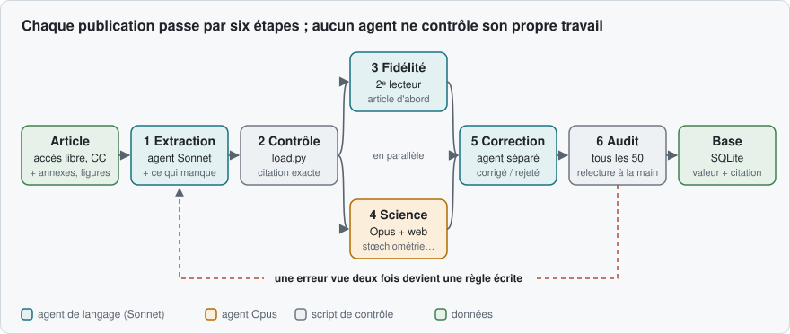</picture></p>

<p align="center"><picture><source media="(prefers-color-scheme: dark)" srcset="docs/img/accueil/chiffres_fr_dark.svg">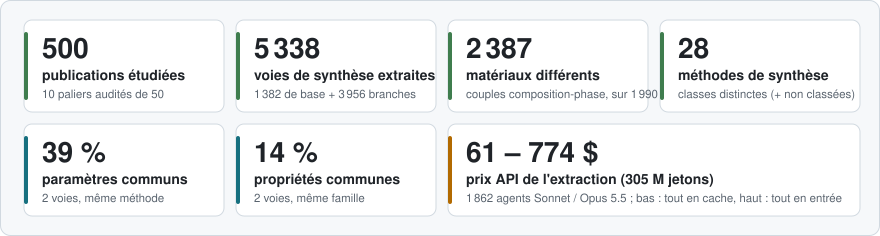</picture></p>

<sub>Matériaux : couples (composition, phase) distincts, hors voies « dispositif ». Paramètres et propriétés communs : similarité de Jaccard moyenne entre deux voies de base de la même méthode (ou famille), sur le vocabulaire canonique. Prix : historique complet de <code>audits/jetons.csv</code> (chaque agent), au tarif API catalogue ; le journal ne sépare pas entrée, sortie et cache, d'où la fourchette ; l'orchestrateur et la ré-extraction à l'aveugle ne sont pas comptés. Calcul : <code>analyses/chiffres_accueil.py</code>.</sub>

## Le modèle de données

Une **voie de base** décrit un protocole complet ; chaque **branche** est une variante testée par les auteurs et ne porte que ce qui change. Chaque valeur est accompagnée de sa citation exacte, et ce que l'article ne dit pas est noté.

<p align="center"><picture><source media="(prefers-color-scheme: dark)" srcset="docs/img/accueil/modele_fr_dark.svg">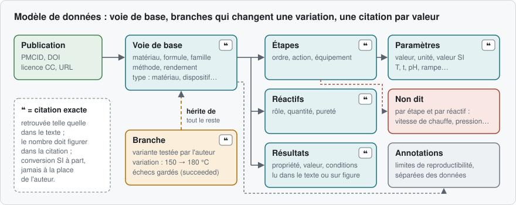</picture></p>

## Un exemple

<p align="center"><picture><source media="(prefers-color-scheme: dark)" srcset="docs/img/accueil/exemple_fr_dark.svg">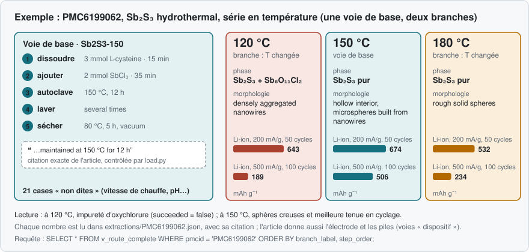</picture></p>

## Ce que contient la base, en un coup d'œil

<table>
<tr><td width="50%" valign="top"><picture><source media="(prefers-color-scheme: dark)" srcset="docs/img/accueil/carte_familles_fr_dark.svg">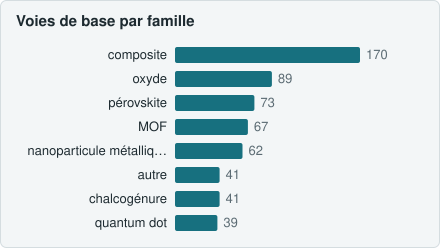</picture><br><sub>747 voies de base de matériau, 17 familles</sub></td><td width="50%" valign="top"><picture><source media="(prefers-color-scheme: dark)" srcset="docs/img/accueil/carte_methodes_fr_dark.svg">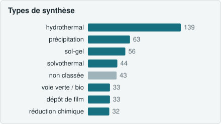</picture><br><sub>8 premières classes sur 29 (mots-clés de la méthode)</sub></td></tr>
<tr><td width="50%" valign="top"><picture><source media="(prefers-color-scheme: dark)" srcset="docs/img/accueil/carte_essentiels_fr_dark.svg">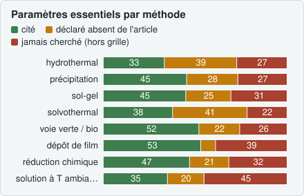</picture><br><sub>vert : cité · orange : l&#x27;article se tait · rouge : hors grille</sub></td><td width="50%" valign="top"><picture><source media="(prefers-color-scheme: dark)" srcset="docs/img/accueil/carte_trous_fr_dark.svg">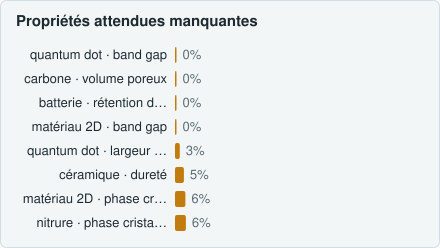</picture><br><sub>part des voies de la famille qui rapportent la propriété</sub></td></tr>
<tr><td width="50%" valign="top"><picture><source media="(prefers-color-scheme: dark)" srcset="docs/img/accueil/carte_branches_fr_dark.svg">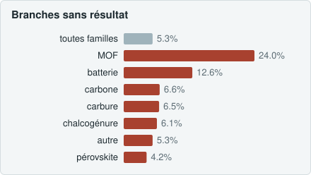</picture><br><sub>variantes testées sans résultat ni caractérisation, en %</sub></td><td width="50%" valign="top"><picture><source media="(prefers-color-scheme: dark)" srcset="docs/img/accueil/carte_mecanismes_fr_dark.svg">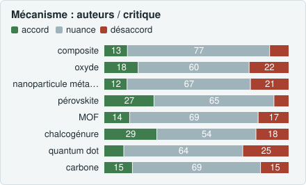</picture><br><sub>512 voies : mécanisme des auteurs jugé par le critique</sub></td></tr>
<tr><td width="50%" valign="top"><picture><source media="(prefers-color-scheme: dark)" srcset="docs/img/accueil/carte_limites_fr_dark.svg">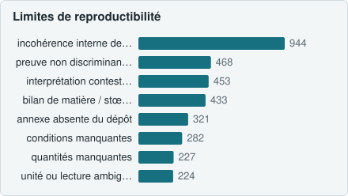</picture><br><sub>83 % des voies de base portent au moins une limite</sub></td><td width="50%" valign="top"><picture><source media="(prefers-color-scheme: dark)" srcset="docs/img/accueil/carte_references_fr_dark.svg">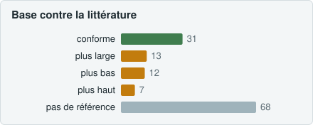</picture><br><sub>31 couples sur 131 dans la plage publiée</sub></td></tr>
<tr><td width="50%" valign="top"><picture><source media="(prefers-color-scheme: dark)" srcset="docs/img/accueil/carte_aveugle_fr_dark.svg">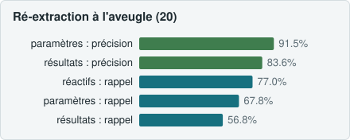</picture><br><sub>20 publications ré-extraites sans voir la base</sub></td><td width="50%" valign="middle"><sub>Chiffres détaillés, méthode et limites : sections repliables ci-dessous, rapports <code>audits/audit_contenu.md</code> et <code>audits/audit_verification.md</code>.</sub></td></tr>
</table>

<!-- SITE:visual:end -->

`synthese.db` (SQLite) rassemble des voies de synthèse de matériaux extraites d'articles en accès libre. **Chaque valeur porte la citation mot pour mot de l'article** qui la fonde, sa position dans le texte, et ce que l'article ne dit pas est noté. Ce document décrit la **version 1** de la base, à la manière d'une section « Matériel et méthodes » : d'où viennent les articles, comment ils sont transformés en données, comment fonctionne le pipeline d'agents, quand une extraction est jugée bonne, ce que contient la base, ce qui lui manque, et la suite prévue (v2).

État au 30 octobre 2026 : 500 publications closes et auditées (dix paliers de 50). Les chiffres viennent de `synthese.db` (requêtes en lecture seule) et des rapports `audits/`.

---

## Résumé

**Objectif.** Permettre à un chimiste de refaire un matériau à partir de la base seule, et de voir comment chaque variation de synthèse testée par les auteurs change le résultat.

**Matériel.** 500 articles originaux en texte intégral et en accès libre (licences Creative Commons), tirés d'Europe PMC, base publique de littérature scientifique : 69 revues, publiés de 2009 à 2026.

**Méthode.** Chaque article passe par un pipeline de six étapes confiées à des agents de langage aux rôles séparés : extraction, contrôle automatique des citations, relecture, deux critiques indépendantes (fidélité au texte, plausibilité scientifique), correction, puis un audit tous les 50 articles. Aucun agent ne contrôle son propre travail, et le texte de l'article tranche tout désaccord.

**Résultats.** 5 338 voies de synthèse (1 382 voies de base, 3 956 branches), 2 387 matériaux différents, 28 classes de méthodes. 95 053 citations vérifiées mot pour mot (100 %) ; 11 285 valeurs relues à la main, dont 16 fausses, toutes corrigées ; une ré-extraction à l'aveugle de 20 publications retrouve 91,5 % des paramètres sans aucun conflit sur les valeurs.

**Limites.** La base est fidèle mais hétérogène : deux voies d'une même méthode n'ont en moyenne que 39 % de paramètres en commun, deux voies d'une même famille 14 % de propriétés en commun. Les conditions de caractérisation sont souvent absentes et la grille de vérification de la v1 est trop courte.

**Suite (v2).** Grille stricte de paramètres par méthode et par caractérisation, vocabulaire adaptatif appliqué dès l'extraction.

---

## 1. Pourquoi cette base

La littérature de synthèse des matériaux est abondante mais peu réutilisable. Les conditions sont dispersées entre Méthodes, Résultats, tableaux, légendes et annexes. Les séries d'échantillons comparées sont décrites par des phrases du type « the same procedure was repeated at 150 and 180 °C ». Les manques (quantité d'un réactif, atmosphère d'un recuit) ne sont pas signalés. Un chimiste qui veut refaire un matériau doit relire l'article entier et deviner le reste.

La base répond à deux questions pour chaque article :

1. **Que dit exactement l'article** pour chaque réactif, chaque étape, chaque paramètre, chaque résultat, et pour chaque variante comparée ?
2. **Que ne dit-il pas**, et qu'est-ce qui, dans ce qu'il dit, est incohérent ou douteux pour un lecteur formé ?

Cible de la v1 : 500 publications, traitées par paliers de 50 publications audités.

## 2. D'où viennent les articles : Europe PMC

### 2.1 Une base publique de littérature scientifique

[Europe PMC](https://europepmc.org) est un dépôt public et gratuit de littérature en sciences de la vie et disciplines voisines : articles, prépublications, livres, thèses.

| | |
|---|---|
| Qui l'opère | l'Institut européen de bioinformatique (EMBL-EBI, Hinxton, Royaume-Uni), en partenariat avec PubMed Central de la National Library of Medicine (États-Unis), dans le réseau PubMed Central International |
| Depuis quand | 2007 (issue de UK PubMed Central et de CiteXplore) |
| Qui la finance | le groupe des financeurs d'Europe PMC (36 organismes de recherche européens, dont le Wellcome Trust et le Conseil européen de la recherche), qui en font le dépôt obligatoire des publications qu'ils financent ; ressource reconnue « Core Data Resource » par ELIXIR |
| Volume | plus de 46 millions de résumés ; environ 12,4 millions d'articles en texte intégral, dont environ 8,4 millions dans le sous-ensemble en accès libre (chiffres du site, octobre 2026) |
| Activité | sous-ensemble en accès libre mis à jour chaque semaine ; la part des articles librement accessibles croît chaque année (près de 58 % des articles de 2025, contre moins de 10 % pour 2005) ; plus de 32 millions d'adresses IP distinctes l'ont consultée en 2023 |

**Qui y publie.** Personne ne publie directement dans Europe PMC. Les éditeurs y déposent le texte intégral de leurs revues (via PubMed Central), les auteurs y déposent leur manuscrit accepté quand leur financeur l'exige, et des serveurs de prépublications y sont indexés. La chimie des matériaux y entre surtout par des revues multidisciplinaires en accès libre. Dans notre corpus : RSC Advances (77 publications), Scientific Reports (63), Nanomaterials (49), Materials (48), Molecules (27), Nanoscale Research Letters (24), ACS Omega (20).

**Pourquoi cette base.** Elle donne le texte intégral en XML structuré (format JATS : sections, tableaux, légendes, bibliographie), la licence de chaque article, et une interface de programmation gratuite. Sa contrepartie : une orientation biomédicale (§ 14.4).

### 2.2 Sélection des articles

- **Filtre** ajouté à chaque requête (`fetch.py`) : `OPEN_ACCESS:y AND IN_EPMC:y AND HAS_FT:y NOT PUB_TYPE:review`, soit des articles originaux, en texte intégral, en accès libre.
- **Requêtes** : une par famille de matériaux (`queries.txt` : MOF et ZIF, nanoparticules métalliques, oxydes, pérovskites, zéolithes et silices mésoporeuses, chalcogénures et phosphures, carbones, matériaux d'électrode, céramiques, matériaux 2D, points quantiques). Elles visent les articles qui **comparent des conditions de synthèse** (« effect of », « optimization », « synthesis conditions »), car ce sont eux qui portent des branches.
- **Licences** : seules les licences Creative Commons sont retenues. Sur les 500 publications : 366 CC BY, 88 CC BY-NC, 45 CC BY-NC-ND, 1 CC BY-NC-SA. Le texte de `corpus/` reste sous la licence de chaque article ; toute réutilisation doit la respecter.
- **Rejets** : un article sans synthèse exploitable (hors sujet, simulation, protocole entièrement renvoyé ailleurs) est écarté à l'extraction, avec sa raison écrite (13 rejets sur 513 articles traités).

### 2.3 Statut des articles : des données, pas des instructions

Articles, annexes et pages web sont des **données non fiables**. Ils sont lus par des bibliothèques, jamais exécutés ; Python est lancé en mode isolé (`-I`) ; chaque agent a pour consigne de ne suivre aucune instruction que ces textes contiendraient. Un article ne doit pas pouvoir influencer la façon dont on le lit.

## 3. Comment un article devient des données

### 3.1 Convertir l'article : pourquoi et comment

**Pourquoi convertir.** La règle centrale de la base est qu'une valeur n'existe que si sa citation est retrouvée **à l'identique** dans l'article. Pour que ce contrôle soit mécanique, l'agent qui lit et le script qui vérifie doivent avoir sous les yeux **le même document, en texte plat**, où chaque passage a une position fixe. Le PDF perd la structure (colonnes, tableaux, exposants) ; le XML JATS la garde. Chaque type de contenu est donc converti selon son rôle :

| Contenu de l'article | Conversion | Outil | Pourquoi |
|---|---|---|---|
| **Texte** (sections) | XML JATS → texte plat découpé par sections | `sections.py` → `corpus/text/<PMCID>.txt` | document de référence unique : toutes les citations et positions (`char_start`, `char_end`) s'y rapportent |
| **Tableaux** | une rangée par ligne, cellules séparées par ` \| ` | `sections.py` | une citation = une rangée = un échantillon ; la rangée est attribuée par le nom de l'échantillon, jamais par sa position |
| **Légendes, notes de tableau** | ajoutées en fin de fichier | `enrich.py` | les légendes portent souvent les conditions de mesure et le nom des échantillons |
| **Annexes** (Supporting Information) | texte extrait des PDF et Word du dépôt PMC, ajouté en fin de fichier | `enrich.py` | les quantités exactes et les séries d'échantillons y sont souvent ; 68 publications citent une annexe absente du dépôt (§ 14.4) |
| **Figures** (images) | téléchargées telles quelles | `enrich.py figs` → `corpus/fig/<PMCID>/` | lues par l'agent seulement quand un résultat n'existe que sur l'image ; valeur marquée `from_figure`, citation = la légende (6 997 résultats sur 39 350) |
| **Références** | texte avec renvois `[[id]]` et bibliographie | `enrich.py` → `corpus/refs/<PMCID>.txt` | un « prepared as described in [12] » devient une source de méthode dont l'identifiant est contrôlé contre la bibliographie |

Les ajouts se font **toujours en fin de fichier**, pour ne décaler aucune citation déjà extraite (2 709 positions recontrôlées lors de l'audit du pipeline du 12 octobre). `enrich.py` est idempotent : relancé sur un article déjà enrichi, il produit le même fichier.

### 3.2 Voies, branches, variations

- Une **voie de base** décrit un protocole complet : matériau visé, méthode, réactifs, étapes ordonnées avec leurs paramètres et leur matériel, caractérisations, résultats, rendement.
- Une **branche** est une variante comparée par les auteurs. Elle hérite des réactifs et des étapes de son parent et déclare **ce qui change et par rapport à quoi** (`route_variations` : valeur du parent, valeur de la branche, citation). Les vues SQL (`v_route_complete`, `v_branches`, `v_comparaison`) reconstituent le protocole complet de n'importe quelle branche.
- Les **essais ratés** sont des branches comme les autres (`succeeded = false`).
- Les **tests du matériau fini** (cyclage, cytotoxicité, dose de catalyseur) sont des résultats, pas des branches. Un post-traitement qui transforme le matériau est une voie `post_treatment` ; la fabrication d'une électrode, d'une cellule ou d'une LED est une voie `device`.

Sur 500 publications : 1 382 voies de base, 3 956 branches, 5 594 variations, 7 714 réactifs, 9 546 étapes, 12 731 paramètres, 39 350 résultats, 9 083 caractérisations.

### 3.3 Traçabilité de chaque valeur

| Colonne | Contenu |
|---|---|
| `quote` | passage copié mot pour mot du texte plat (°, ·, −, indices compris), assez long pour être sans ambiguïté, une seule rangée pour un tableau |
| `char_start`, `char_end` | position du passage dans `corpus/text/<PMCID>.txt` |
| `value_num` + `unit` ou `value_text` | la valeur telle qu'écrite ; « room temperature », « overnight » restent du texte |
| `value_si`, `unit_si` | conversion SI faite par `load.py`, dans une colonne séparée, jamais à la place de la valeur d'origine |
| `from_figure` | pour une valeur lue sur une image : la figure et le panneau |

Deux structures rendent **l'absence** explicite :

- `not_stated` (28 631 cases sur les publications closes) : chaque information de la grille de reproductibilité (§ 4.2.1) est **soit extraite avec sa citation, soit déclarée non dite** après recherche dans tout l'article.
- `doubts` (6 761) : chaque ambiguïté qui touche une donnée ou le découpage en branches, avec les lectures possibles et la lecture retenue, tranchée par l'orchestrateur.

### 3.4 Données et interprétations

Les **annotations** (10 582, en français, `source = 'claude'`) sont des interprétations séparées des données : résumé, objectif, conclusion des auteurs, comparaison des branches, mécanisme, sécurité, et **limite de reproductibilité** (4 558) : tout ce qu'un chimiste doit savoir avant de refaire la synthèse. Une annotation qui rapporte les auteurs exige une citation ; une annotation d'analyse n'en a pas, pour que les deux ne se confondent jamais.

Les **sources de méthode** (1 052) listent les renvois bibliographiques nécessaires pour refaire une préparation (« according to », « as described in », « modified … method »).

## 4. Le pipeline : qui fait quoi

### 4.1 Le pipeline en clair

<p align="center"><picture><source media="(prefers-color-scheme: dark)" srcset="docs/img/accueil/pipeline_fr_dark.svg"></picture></p>

Le pipeline fonctionne comme un laboratoire d'analyse où chaque échantillon passe entre plusieurs mains :

1. **Un lecteur extrait** l'article : il note chaque réactif, chaque étape, chaque résultat, avec la phrase de l'article qui le dit, et la liste de ce que l'article ne dit pas.
2. **Une machine contrôle** que chaque phrase citée existe bien, à l'identique, dans l'article.
3. **Un responsable relit** les points douteux, et une fiche sur cinq en entier.
4. **Deux experts indépendants** relisent : l'un vérifie que rien n'a été mal recopié ou oublié, l'autre que la chimie décrite par les auteurs tient debout.
5. **Un correcteur** applique les décisions du responsable.
6. **Un audit** recontrôle tout le lot tous les 50 articles avant de passer au suivant.

### 4.2 Le pipeline en détail : consignes et règles de vérification

<p align="center"><picture><source media="(prefers-color-scheme: dark)" srcset="docs/img/accueil/pipeline_detail_fr_dark.svg">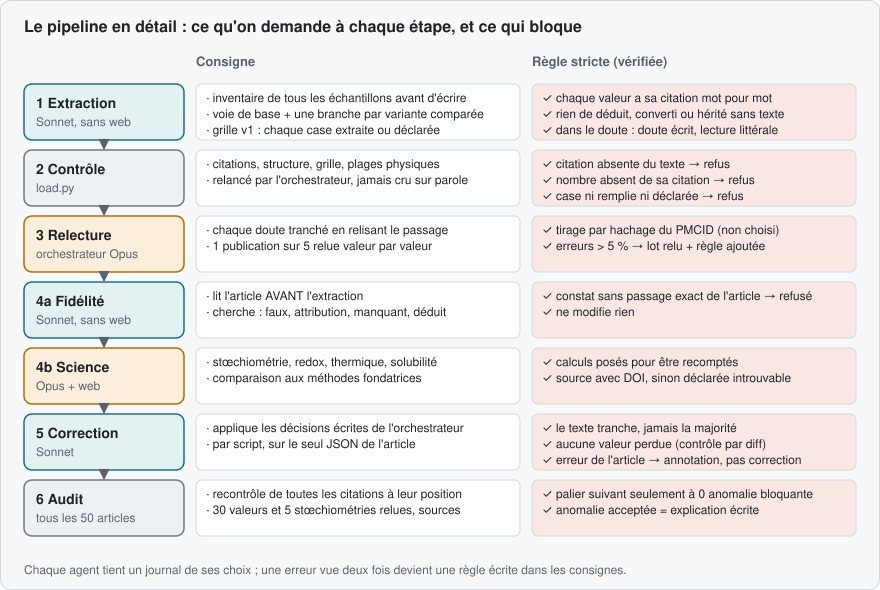</picture></p>

Chaque agent reçoit des consignes écrites et versionnées (`RUNBOOK.md`, `CRITIQUE.md`, `PLAUSIBILITE.md`, `PROMPT_CORRECTION.md`). Il écrit un **journal de décisions** (`journaux/<PMCID>_<passe>.md`, 10 à 30 lignes sur ses choix non évidents). Aucun agent n'est cru sur parole : l'orchestrateur relance lui-même les contrôles et ne lit que les produits (JSON, journal, rapport court).

#### 4.2.1 Extracteur (`RUNBOOK.md`)

Règles absolues :

1. Chaque donnée porte sa citation exacte.
2. Rien d'inventé, de déduit ou de converti ; une valeur absente reste absente et va dans `not_stated`.
3. Toutes les variations comparées deviennent des branches, échecs compris ; Résultats et tableaux sont lus, car les séries y sont souvent définies.
4. Dans le doute, ne pas trancher : écrire le doute et extraire la lecture la plus littérale.
5. Pas de synthèse exploitable → rejet motivé.

**Inventaire avant d'écrire.** Avant toute voie, l'extracteur liste **tous les échantillons nommés ou comparés** : où chacun est défini, ce qui le distingue, où sont ses résultats. Une rangée de tableau = un échantillon, attribuée par son nom ; avec « respectively », l'ordre est écrit avant toute attribution. Cette règle vient des trois erreurs les plus fréquentes du premier palier (valeur rangée sur le mauvais échantillon, étape héritée sans que l'article le dise, branche oubliée).

**Liste de vérification de la v1 (grille de reproductibilité).** Pour chaque élément, chaque information attendue est soit extraite avec sa citation, soit déclarée « non dite » ; `load.py` refuse toute case ni remplie ni déclarée, ou les deux à la fois. C'est une liste courte, définie par **type d'étape** et non par méthode de synthèse :

| Élément | Informations attendues |
|---|---|
| Voie de base | rendement |
| Réactif (sauf lavage, gaz, substrat) | quantité, pureté, fournisseur |
| Chauffage, réaction, reflux, vieillissement | température, durée |
| Calcination, recuit, frittage, pyrolyse | température, durée, atmosphère, vitesse de chauffe |
| Séchage | température, durée |
| Agitation, mélange, ultrasons, dispersion | durée |
| Centrifugation | vitesse, durée |
| Lavage | solvant, nombre de lavages |
| Ajustement du pH | pH |

L'extracteur peut ajouter toute autre information manquante (vitesse d'agitation, refroidissement, taux de remplissage…), mais sans obligation : c'est la principale faiblesse de la v1 (§ 8).

**Annexes, figures, références.** L'extracteur lit légendes, notes de tableau et annexes en entier. Une valeur qui n'existe que sur une figure est lue sur l'image (deux chiffres significatifs au plus) et marquée `from_figure`. Un protocole renvoyé à une autre publication devient une source de méthode, jamais une valeur complétée de mémoire.

#### 4.2.2 Contrôle automatique (`load.py`)

`load.py check` refuse l'extraction si une règle est violée ; `load.py load` ne charge qu'à zéro erreur. Ces contrôles sont des **invariants** : on ne les affaiblit jamais pour faire passer une extraction.

| Famille | Règle stricte |
|---|---|
| Citation | présente, assez longue, **retrouvée telle quelle dans le texte plat** ; pour chaque nombre et chaque quantité de réactif, **le nombre apparaît dans sa citation** (1,5 / 1.5 / 1·5 reconnus), sauf valeur lue sur figure |
| Structure | libellés uniques ; parents existants, sans cycle ; une branche déclare au moins une variation ; étapes numérotées sans trou |
| Grille | chaque case de la liste v1 extraite ou déclarée, jamais les deux |
| Valeurs | unité pour un nombre ; pH entre 0 et 14 ; durée positive ; température physiquement possible |
| Annotations et sources | annotations obligatoires présentes ; citation exigée quand on rapporte les auteurs ; chaque renvoi existe dans la bibliographie |

Un autotest vérifie que chaque cas fautif (citation altérée, nombre absent, branche sans variation, pH impossible, case oubliée) est bien refusé.

#### 4.2.3 Relecture de l'orchestrateur

- **Toujours** : chaque doute est tranché en relisant le passage, avec la résolution écrite ; la présence de toutes les branches est vérifiée en parcourant tableaux et Résultats, rangée par rangée.
- **Relecture intégrale** (chaque valeur comparée à l'article : valeur, unité, étape, branche, citation) des 10 premières publications, puis d'**une publication sur cinq tirée par le hachage SHA-1 de son identifiant** : le tirage est déterministe et ne peut pas être choisi.
- **Seuil** : si plus de 5 % des valeurs relues sont fausses, tout le lot est relu et la règle qui évite l'erreur est ajoutée aux consignes.

#### 4.2.4 Critique de fidélité (`CRITIQUE.md`)

Un second agent lit **l'article avant l'extraction**, dresse sa propre liste d'échantillons, puis cherche, par ordre d'importance : valeur fausse, mauvaise attribution, branche manquante ou inventée, « non dit » à tort, valeur déduite présentée comme citée, étape mal découpée, source de méthode manquante, annotation infidèle. Chaque constat porte une gravité, une certitude et **ce que dit l'article en citation exacte** : `critic_load.py` refuse un constat dont la citation n'est pas dans le texte. Ce critique n'a pas accès au web et ne modifie rien.

#### 4.2.5 Critique scientifique (`PLAUSIBILITE.md`)

Un troisième agent juge le **protocole des auteurs**, voie par voie : température contre récipient (point d'ébullition, autoclave), quantités converties en moles et comparées à la formule visée, grandeurs dérivées recalculées (Bragg, Scherrer, rendement), vocabulaire physique, témoin qui change plusieurs variables, cohérence entre sections, preuve discriminante, sécurité non écrite. Trois règles le rendent contrôlable :

- **calculs posés** (entrées, formule, résultat, source de chaque constante) pour être recomptés ;
- **sources vérifiables** (titre, auteurs, année, DOI) ; une référence introuvable est déclarée, jamais inventée ;
- **bibliothèque avant le web** : `references/fondateurs.md` (papiers fondateurs par famille, DOI vérifiés sur Crossref) et `references/constantes.md` ; une dizaine de recherches web par article au plus.

Chaque voie reçoit un verdict (cohérente, douteuse, incohérente, invérifiable) et la liste de ce qu'un chimiste devrait vérifier.

#### 4.2.6 Correction

L'orchestrateur fixe par écrit, constat par constat, ce qui est corrigé ou rejeté :

- **le texte tranche, jamais la majorité** ;
- contradiction interne de l'article : la valeur littérale du tableau est gardée, l'autre signalée ;
- aucun héritage non fondé ;
- **les problèmes qui viennent de l'article deviennent des annotations « limite de reproductibilité », jamais des corrections** : la base ne répare pas un article.

Un agent applique ces décisions **par script**, sur le seul fichier JSON de la publication. L'orchestrateur vérifie ensuite qu'aucune valeur n'a été perdue (`diff_valeurs.py`), relance `load.py`, contrôle quelques ajouts contre le texte et consigne le statut de chaque constat.

#### 4.2.7 Clôture et sauvegarde

Une publication est close quand ses deux critiques sont traitées. Chaque chargement et chaque clôture font l'objet d'un commit git poussé : l'histoire de chaque valeur (extraction, correction, raison) est consultable.

### 4.3 Le choix des modèles

Les modèles ont été choisis sur un pilote, puis confirmés par les mesures des premiers paliers, selon trois critères : **exactitude de la recopie** sur des textes longs à caractères spéciaux, **capacité de raisonnement** chimique, et **coût par publication**.

| Rôle | Modèle | Effort | Pourquoi |
|---|---|---|---|
| Orchestrateur | Opus | élevé | arbitrage, relecture contre le texte, découpage en branches ; un effort moyen laissait passer des attributions fausses |
| Extraction | Sonnet | élevé | lecture exhaustive (annexes, tableaux) et citations mot pour mot ; un effort plus bas sautait des cases de la grille |
| Critique de fidélité | Sonnet | élevé | même exigence de lecture complète ; **même modèle que l'extracteur, volontairement** : c'est l'indépendance de la lecture (article lu en premier) qui est recherchée, pas la différence de modèle |
| Critique scientifique | Opus | élevé | raisonnement de chimie, stœchiométrie, recherche de sources |
| Correction | Sonnet | élevé | lecture ciblée et application par script |

Écartés : **Haiku** (trop d'erreurs de recopie sur des textes longs à caractères spéciaux), **Fable** (2,5 fois le prix d'Opus sans gain mesuré sur ces tâches), les efforts « très élevé » et « maximal » (coût sans gain observé sur le pilote). Coût mesuré : environ 0,9 M jetons par publication au premier palier, puis 0,6 à 0,7 M, répartis à peu près également entre extraction, critique de fidélité, critique scientifique et correction.

## 5. Quand une extraction est-elle jugée bonne et valide ?

### 5.1 Les critères de validité

Dans ce pipeline, une extraction est déclarée **valide** quand toutes les conditions suivantes sont remplies, dans l'ordre :

1. `load.py check` rend **zéro erreur** : chaque citation est retrouvée à l'identique, chaque nombre figure dans sa citation, chaque case de la grille est extraite ou déclarée.
2. **Chaque doute est tranché**, avec sa résolution écrite.
3. La **critique de fidélité** est faite et chacun de ses constats a un statut : corrigé, rejeté avec motif, ou accepté avec explication.
4. La **critique scientifique** est faite ; les problèmes venant de l'article sont restitués en limites de reproductibilité.
5. La **correction** est vérifiée : aucune valeur perdue, rechargement à zéro erreur, ajouts contrôlés contre le texte.
6. La publication est **close** et sauvegardée.

Puis, à l'échelle du palier de 50 publications :

7. L'audit rend **zéro anomalie bloquante**, et chaque avertissement est traité en retournant à l'article (corrigé, ou accepté avec explication écrite).
8. Le **taux d'erreur des relectures intégrales** reste sous 5 % ; au-delà, tout le lot est relu.

« Valide » signifie **fidèle à l'article et explicite sur ses manques**. Cela ne signifie pas que le protocole fonctionne :

| Niveau | Affirmation | Comment elle est établie | Degré |
|---|---|---|---|
| **Fidélité** | « La base dit ce que l'article dit. » | citation exacte et position ; second lecteur sur 100 % des publications ; relecture intégrale d'une sur cinq | **mesuré** (§ 5.3) |
| **Complétude** | « La base dit ce que l'article dit d'utile, et déclare le reste. » | grille de reproductibilité, inventaire des échantillons, constats « manquant » du critique | **contrôlé**, sans garantie d'exhaustivité (§ 14) |
| **Cohérence** | « Ce que dit l'article tient physiquement et chimiquement. » | tests automatiques ; critique scientifique sourcée | **opinion sourcée**, incohérences restituées sans correction |
| **Validité expérimentale** | « Le protocole donne le matériau décrit. » | — | **non établie** : seule une reproduction au laboratoire peut le dire |

### 5.2 Les contrôles de l'audit de palier

Tous les 50 articles, `audit.py N` relance des contrôles sur tout le palier et écrit `audits/palier_NNN.md` :

| Famille | Contrôle | Gravité |
|---|---|---|
| Citation | chaque citation relue **à sa position** dans le texte ; absente → bloquant ; nombre absent de sa citation → bloquant | bloquant / avertissement |
| Physique | valeur SI incohérente ; pH hors 0–14 ; température au-dessus de l'ébullition du solvant sans autoclave ni reflux ; durée de plus de 30 jours | bloquant / avertissement |
| Chimie | chaque élément du produit doit venir d'un réactif ; atmosphère cohérente avec l'état d'oxydation | avertissement / information |
| Cohérence | annotation obligatoire absente ; doute non tranché ; branche sans variation ; relecture due non faite | bloquant / avertissement |

S'y ajoutent des contrôles manuels : 30 valeurs tirées au hasard (graine fixe) relues une par une ; stœchiométrie de 5 voies recalculée ; synthèses d'un même matériau comparées entre publications (`compare.py`) ; un échantillon de sources du critique scientifique ouvert et vérifié (une source inventée est une anomalie bloquante). Chaque palier a son rapport de relecture (`audits/palier_NNN_relecture.md`), qui dit aussi **ce qui n'a pas été vérifié**.

### 5.3 Ce que les contrôles ont mesuré sur les 500 publications

| Contrôle | Résultat |
|---|---|
| Citations vérifiées à leur position | 95 053, **100 % exactes** |
| Relectures intégrales | 11 285 valeurs relues, 16 fausses, toutes corrigées : 10 dans les publications de calibrage (1,6 %), puis 6 sur 10 724 (0,06 %) |
| Critique de fidélité | 4 345 constats : 4 157 corrigés, 169 rejetés avec motif, 19 acceptés ; 90 classés « faux » |
| Doutes | 6 761, tranchés avec résolution écrite (15 encore ouverts) |
| Critique scientifique | 2 983 voies jugées : 1 149 cohérentes, 1 493 douteuses, 108 incohérentes, 233 invérifiables ; problèmes restitués dans 4 558 limites de reproductibilité, aucune valeur changée |
| Audits de palier | 0 anomalie bloquante sur les dix paliers ; avertissements surtout des faux positifs du contrôle chimique, chacun accepté avec sa raison |

Le verdict « douteuse » recouvre surtout des réserves (information manquante pour conclure, témoin à plusieurs variables). Les problèmes viennent des articles, pas des extractions : une teneur en cobalt supérieure à celle du cobalt pur, un « laser HeNe à 532 nm », une dispersion aqueuse « agitée à 350 °C ».

### 5.4 Amélioration continue

Une erreur vue deux fois devient une règle écrite dans les consignes, avec sa date. Les consignes étant versionnées, l'état des règles au moment où chaque publication a été traitée est reconstituable. C'est ainsi que le taux d'erreur est passé de 1,6 % au calibrage à 0,06 % ensuite.

## 6. Nettoyage de la base

Cinq cents publications lues par des agents différents produisent un vocabulaire libre : le même paramètre ou la même propriété porte des noms différents d'un article à l'autre, et la méthode est une phrase. Pour comparer les voies entre elles, la base a été nettoyée **après coup**, sans toucher aux valeurs.

### 6.1 Noms en trop : un vocabulaire canonique

`canon.py` associe à chaque nom écrit par un extracteur un **nom canonique** et un groupe, dans des colonnes séparées (`parameters.name_canon`, `outcomes.property_canon`, `outcomes.property_group`) ; les noms d'origine restent intacts.

| | Occurrences | Noms écrits | Noms canoniques | Non classés |
|---|---|---|---|---|
| Paramètres d'étape | 12 731 | 682 | 37 | 0,9 % |
| Propriétés mesurées | 39 350 | 16 577 | 95 | 9,1 % (25,8 % avant) |

Exemples : `temperature_final`, `temperature_initial`, `temperature_start` → `temperature` ; 62 noms de durée → `duration`. Table de correspondance complète : `docs/vocabulaire/`.

### 6.2 Méthodes fusionnées

La méthode est écrite en texte libre (« template-free hydrothermal reaction at 150 °C »). Une table de mots-clés la range dans **28 classes** (hydrothermal, précipitation, sol-gel, solvothermal, voie verte, dépôt de film, réduction chimique…), plus une classe « non classée » (43 voies de base). Une seconde classification, indépendante, tirée de la suite des étapes, concorde avec la première pour **68,8 %** des voies.

### 6.3 Doublons et unités

45 matériaux apparaissent sous plusieurs noms et 88 variantes d'unités ont été relevées ; 71 % des paramètres numériques ont une valeur SI (température, durée et rampe à 99 % ; jamais les volumes, concentrations et vitesses, une limite de `load.py`).

### 6.4 Ce que le nettoyage ne fait pas

Il ne change aucune valeur, ne fusionne aucune voie, et ses règles sont regénérables (`python3 -I canon.py apply`). C'est un nettoyage par expressions régulières, appliqué après l'extraction : il laisse 9,1 % des propriétés sans classe (§ 8).

<!-- SITE:analysis:begin -->
<a id="analysis"></a>

## 7. Ce que contient la base : les résultats

Deux audits de contenu (28 octobre 2026) examinent ce que contiennent réellement les 500 publications et si l'extraction est fiable. Tout est reproductible : `python3 -I analyses/audit_contenu.py`, `audit_parametres.py`, `audit_verification.py`, `compare_blind.py`, puis `build_site.py` pour cette page.

| **747** | **29** | **96** | **83 %** | **512** | **20** |
|---|---|---|---|---|---|
| voies de base d'un matériau | classes de méthode | propriétés canoniques (sur 16 577 noms) | des voies de base avec une limite | mécanismes comparés | publications ré-extraites à l'aveugle |

<details><summary><b>1. Ce que contient la base</b></summary>

<p align="center"><picture><source media="(prefers-color-scheme: dark)" srcset="docs/img/familles_fr_dark.svg"></picture></p>

<p align="center"><picture><source media="(prefers-color-scheme: dark)" srcset="docs/img/methodes_fr_dark.svg"></picture></p>

- **hydrothermal domine** (18,6 % des voies de base), puis précipitation, sol-gel et solvothermal. Deux classements indépendants (mots-clés de la méthode, enchaînement des étapes) concordent à **68,8 %**.
- Les 16 577 noms de propriétés libres sont ramenés à **96 propriétés canoniques** par une table d'expressions régulières ; **9,1 % des valeurs** restent non classées (noms trop spécifiques). Avant toute exploitation statistique, une liste fermée de noms est à fixer.

</details>

<details><summary><b>2. Paramètres communs et paramètres essentiels</b></summary>

<p align="center"><picture><source media="(prefers-color-scheme: dark)" srcset="docs/img/essentiels_fr_dark.svg"></picture></p>

- **Température et durée sont les seuls paramètres universels** (90 à 100 % des voies des méthodes principales). Au-delà, deux voies d'une même méthode ne partagent que 25 à 45 % de leurs types de paramètres (similarité de Jaccard de 0,19 à 0,43).
- **Les articles sont la première source de manque.** Pour les méthodes en autoclave, 39 % des paramètres essentiels ne sont pas donnés par l'article (et l'extracteur l'a écrit) ; le taux de remplissage est cité dans 1 à 5 % des voies, les rampes de chauffe et de refroidissement dans moins de 12 %.
- **L'extraction a ses angles morts** : vitesse de refroidissement, débit de gaz, répétitions de cycles, puissance, taux de remplissage ne figurent pas dans la grille de reproductibilité, donc ne sont ni cités ni déclarés absents.
- Les quantités de précurseurs, elles, sont données pour 87 % (hydrothermal) à 97 % (voies vertes) d'entre eux, et déclarées absentes quand elles manquent : aucun manque silencieux.

</details>

<details><summary><b>3. Trous de couverture</b></summary>

<p align="center"><picture><source media="(prefers-color-scheme: dark)" srcset="docs/img/trous_fr_dark.svg"></picture></p>

- **132 cases famille × méthode sur 175** comptent moins de 5 voies : hors hydrothermal et sol-gel, chaque méthode n'est représentée que par une poignée de voies par famille (électrochimie : 4 voies en tout).
- **43 couples famille-propriété attendus** sont couverts à moins de 30 % : band gap et rendement quantique des pérovskites, surface BET des carbones, rétention de capacité des batteries, densité et dureté des céramiques.
- Familles trop peu représentées : carbures (3 voies), phosphures (1), nitrures (17), matériaux 2D (18). Absentes ou noyées dans « autre » : polymères, verres, alliages, COF, électrolytes solides, thermoélectriques.

</details>

<details><summary><b>4. Qualité des données</b></summary>

<p align="center"><picture><source media="(prefers-color-scheme: dark)" srcset="docs/img/branches_fr_dark.svg"></picture></p>

- **Branches** : 5,3 % sans résultat ni caractérisation, mais 24 % chez les MOF (séries de conditions dont l'article ne rapporte qu'un résultat global).
- **Stœchiométrie nominale** : sur 60 voies contrôlables, 24 concordent à moins de 10 % avec la formule du produit ; les écarts importants sont des excès voulus ou des précurseurs apportés par une voie intermédiaire, pas des erreurs.
- **8 valeurs hors plage physique**, toutes recopiées de l'article (rendements quantiques de 112 à 241 % pour des points de carbone, mesurés par rapport à un étalon).
- **Normalisation** : 682 noms de paramètres pour 27 types ; 71 % des paramètres numériques ont une valeur SI (température, durée, rampe à 99 % ; jamais les volumes, concentrations, vitesses : limite de `load.py`).
- **Variation → effet** : 61 % des 3 064 variations numériques ont une propriété mesurée des deux côtés ; 693 séries de 3 points ou plus, dont 56 % monotones. Un changement de température déplace les propriétés de taille et de texture de 40 à 50 % en médiane, un changement de réactif les propriétés optiques de moins de 10 %.

</details>

<details><summary><b>5. Limites de reproductibilité et mécanismes</b></summary>

<p align="center"><picture><source media="(prefers-color-scheme: dark)" srcset="docs/img/limites_fr_dark.svg"></picture></p>

<p align="center"><picture><source media="(prefers-color-scheme: dark)" srcset="docs/img/mecanismes_fr_dark.svg"></picture></p>

- **83 % des voies de base** portent au moins une limite ; la première cause est l'incohérence interne de l'article (21 %), devant les preuves non discriminantes (10 %), les interprétations contestées (10 %) et les bilans de matière impossibles (9,5 %).
- Sur 512 voies, le mécanisme des auteurs et celui du critique scientifique sont en **accord pour 83**, en **nuance pour 346** (dont 106 articles qui ne décrivent aucun mécanisme) et en **désaccord pour 83** ; **25** mécanismes sont contredits par les conditions extraites (réduction sans réducteur, AgCl précipité avant toute réduction…).
- Travaux fondateurs le plus souvent absents alors qu'ils fondent la méthode : Iravani 2011 (29), Cundy & Cox 2003 (16), Essner et al. 2018 (15).

</details>

<details><summary><b>6. Comparaison à la littérature</b></summary>

<p align="center"><picture><source media="(prefers-color-scheme: dark)" srcset="docs/img/references_fr_dark.svg"></picture></p>

- Sur 131 couples matériau-propriété, 31 sont dans la plage publiée. Écarts nets : band gap du SnS (médiane 2,81 eV contre 1,07–1,40 eV massif), photoluminescence du CdS (580 nm contre 490–505 nm : émission de pièges), silices « mésoporeuses » (BET 274 contre 400–1 137 m²/g), volume microporeux du ZIF-8 (0,15 contre 0,52–0,62 cm³/g).
- Les bases structurées (CoRE MOF, IZA, Materials Project) ne sont pas joignables depuis l'environnement d'exécution ; les plages viennent du web, avec l'URL réellement consultée.

</details>

<details><summary><b>7. Vérification par ré-extraction à l'aveugle</b></summary>

<p align="center"><picture><source media="(prefers-color-scheme: dark)" srcset="docs/img/aveugle_fr_dark.svg"></picture></p>

- 20 publications tirées au sort ont été ré-extraites par un agent qui n'a vu ni l'extraction en base ni les critiques : 167 voies sur 172 appariées. **91,5 % des paramètres et 83,6 % des résultats** trouvés à l'aveugle sont dans la base, avec **0 conflit** sur les valeurs univoques.
- Le rappel plus bas (68 % des paramètres, 57 % des résultats) mesure l'apport des critiques : la base contient environ 30 % de paramètres et 40 % de résultats de plus qu'une extraction seule. Les désaccords restants sont des attributions d'une valeur à un autre échantillon ou à une autre voie.

</details>


### Rapports complets

- [audits/audit_contenu.md](https://github.com/TerryChauvin/synthgraph-multi-agent-cloud/blob/main/audits/audit_contenu.md) — types de synthèse, propriétés, conditions, trous, qualité, mécanismes, références
- [audits/audit_verification.md](https://github.com/TerryChauvin/synthgraph-multi-agent-cloud/blob/main/audits/audit_verification.md) — paramètres par méthode et sept contrôles de vérification
- [audits/palier_010_relecture.md](https://github.com/TerryChauvin/synthgraph-multi-agent-cloud/blob/main/audits/palier_010_relecture.md) — dernier audit de palier

<!-- SITE:analysis:end -->

### En résumé : les chiffres clés de la v1

| | |
|---|---|
| Publications étudiées | 500 |
| Voies de synthèse extraites | 5 338 (1 382 de base, 3 956 branches) |
| Matériaux différents (couples composition-phase) | 2 387, sur 1 990 compositions |
| Méthodes de synthèse | 28 classes |
| Paramètres communs entre deux voies d'une même méthode | 39 % (similarité de Jaccard moyenne) |
| Propriétés communes entre deux voies d'une même famille | 14 % |
| Prix API de l'extraction | 61 à 774 $ pour 305 M jetons consignés (1 862 agents) ; bas : tout en lecture de cache, haut : tout en entrée ; orchestrateur non compté |

Calcul : `analyses/chiffres_accueil.py`.

## 8. Ce qui manque encore : critique des résultats

**Une base qui demande un nettoyage.** Le vocabulaire libre des extracteurs a produit 682 noms de paramètres et 16 577 noms de propriétés. Le nettoyage après coup (§ 6) en ramène l'essentiel à un vocabulaire commun, mais par expressions régulières, avec 9,1 % de propriétés encore sans classe et une méthode qui reste une phrase.

**Une base longue et coûteuse à obtenir.** Treize jours de travail (du 12 au 25 octobre 2026), 305 millions de jetons consignés pour les agents, sans compter l'orchestrateur ; cinq agents par publication ; environ 13 publications par fenêtre d'usage de cinq heures. Le coût est le prix de la rigueur (deux critiques indépendantes par article), mais il limite le passage à l'échelle.

**Des propriétés et des caractérisations manquantes.** Deux voies d'une même famille n'ont que 14 % de propriétés en commun : chaque article mesure autre chose. Quand une technique de mesure est citée dans l'article, l'extraction n'a souvent ni ses conditions ni de résultat rattaché : 67 % des mesures de composition (ICP, EDS), 65 % des XPS, 52 % des BET (`audits/sonde_manques.md`). 43 couples famille-propriété attendus sont couverts à moins de 30 % (band gap des pérovskites, surface BET des carbones, rétention de capacité des batteries).

**Pas de grille stricte par méthode ni par caractérisation.** La liste de vérification de la v1 est définie par type d'étape (§ 4.2.1), pas par méthode. Résultat : deux voies d'une même méthode ne partagent que 39 % de leurs paramètres ; pour les méthodes en autoclave, 39 % des paramètres essentiels ne sont pas donnés par l'article ; le refroidissement, le débit de gaz, le nombre de répétitions, la puissance et le taux de remplissage ne sont **jamais cherchés**, car hors grille.

**Ce dont un chimiste a besoin.** Pour refaire une synthèse ou comparer deux voies, un chimiste a besoin d'une **grille stricte de paramètres à vérifier** :

- **par méthode de synthèse** : par exemple, pour une voie hydrothermale, température, durée, taux de remplissage de l'autoclave, vitesse de chauffe, refroidissement, pH et volume ;
- **par caractérisation** : par exemple, pour la DRX le rayonnement, la plage angulaire et le pas ; pour la BET la température et la durée de dégazage ; pour la XPS la source et la référence d'étalonnage.

Sans cette grille, la base dit fidèlement ce que l'article donne, mais ne permet ni de comparer deux voies sur les mêmes critères, ni de juger d'un coup d'œil si une voie est reproductible.

## 9. Intérêt du travail et suite (v2)

### 9.1 Ce que la v1 apporte

- **Une fidélité mesurée, pas affirmée** : chaque valeur est réfutable en moins d'une minute, en ouvrant le texte à la position indiquée ; le taux d'erreur est donné avec son dénominateur.
- **L'absence comme donnée** : 28 631 cases « non dites » montrent ce qu'un article ne donne pas, au lieu de le cacher.
- **L'effet des variations** : les branches relient une condition de synthèse à un résultat ; 61 % des 3 064 variations numériques ont une propriété mesurée des deux côtés.
- **Les limites de reproductibilité** : 83 % des voies de base portent au moins une limite, d'abord des incohérences internes des articles.
- **Un pipeline réutilisable** : consignes, contrôles, critiques et audits sont écrits, versionnés et applicables à d'autres corpus.

Les principes qui fondent la confiance sont ceux d'un travail scientifique : traçabilité intégrale, règles fixées avant la lecture et modifiées par écrit, lecture indépendante, échantillonnage non choisi, conservation des incohérences des auteurs, séparation des observations et des interprétations, invariants que personne ne contourne.

### 9.2 Comparaison avec les méthodes fondatrices

La critique scientifique juge un protocole **par rapport à la méthode qui fonde sa famille** : injection à chaud de Protesescu pour les nanocristaux CsPbX3, excès de 2-méthylimidazole de Pan pour ZIF-8 en eau, citrate de Turkevich et Frens pour l'or, bilans réducteurs de Raveendran pour les synthèses vertes. Un écart est signalé avec sa source et devient une limite de reproductibilité si l'article ne l'explique pas. Cette comparaison sert à dire quoi vérifier, jamais à modifier une valeur.

### 9.3 Travaux futurs : la v2

1. **Une grille complète par méthode.** Passer de la liste par type d'étape à une liste de paramètres essentiels **par méthode de synthèse** (déjà esquissée pour une vingtaine de méthodes dans `analyses/audit_parametres.py`), rendue obligatoire au contrôle : chaque paramètre essentiel extrait ou déclaré non dit.
2. **Un vocabulaire adaptatif.** Appliquer le vocabulaire canonique **dès l'extraction** : l'extracteur choisit dans la liste, propose un terme nouveau quand aucun ne convient, et l'orchestrateur le valide ou le rattache. Le vocabulaire s'enrichit au fil des articles au lieu d'être nettoyé après coup.
3. **Des paramètres de caractérisation.** Une grille par technique (DRX, BET, XPS, MEB/MET, UV-visible, électrochimie…) avec ses conditions de mesure attendues, extraites ou déclarées non dites, comme pour la synthèse.

Un premier essai de complément ciblé sur 20 publications (`audits/pilote_complement.md`) a ajouté des conditions de mesure et des résultats sans retirer aucune valeur, pour environ 139 000 jetons par publication : il sert de base de travail à la v2.

## 10. Vérifier soi-même

```bash
python3 -I load.py check PMC1234567          # relance tous les contrôles sur une extraction
python3 -I audit.py 3                        # relance l'audit d'un palier
python3 -I echantillon.py 100 7              # 100 valeurs au hasard (graine 7) avec leur passage, en page HTML
python3 -I review.py PMC1234567              # vue compacte d'une extraction, citations comprises
python3 -I fiche.py PMC1234567               # fiche lisible → fiches/PMC1234567.md
python3 -I compare.py "ZIF-8"                # toutes les synthèses d'un matériau
python3 -I diff_valeurs.py PMC1234567        # valeurs perdues entre deux versions d'une extraction
python3 -I analyses/couverture_valeurs.py    # part des nombres de l'article présents dans la base
```

En SQL, chaque ligne porte `quote`, `char_start`, `char_end` : vérifier une valeur revient à comparer `quote` au contenu de `corpus/text/<PMCID>.txt` entre ces deux positions.

## 11. Refaire tourner le pipeline

| Fichier | Rôle |
|---|---|
| `CLAUDE.md` | boucle de travail de l'orchestrateur, rôles, modèles et efforts, audit de palier |
| `RUNBOOK.md`, `CRITIQUE.md`, `PLAUSIBILITE.md`, `PROMPT_CORRECTION.md` | consignes des agents |
| `schema.sql`, `db.py` | schéma, vues, accès commun |
| `fetch.py`, `sections.py`, `enrich.py` | corpus : recherche, texte, annexes, figures, références |
| `load.py`, `reload_all.py`, `canon.py` | contrôles, chargement, vocabulaire canonique |
| `state.py` | file de travail, tirage des relectures, statuts |
| `critic_load.py`, `relabel.py` | chargement contrôlé des critiques |
| `audit.py`, `sources_check.py`, `compare.py`, `echantillon.py`, `diff_valeurs.py` | audit et vérification |
| `analyses/` | audits de contenu et de vérification, chiffres clés, graphiques et page d'accueil (`build_site.py`) |
| `references/` | bibliothèque du critique scientifique et sa vérification Crossref |
| `extractions/`, `critiques/`, `journaux/`, `fiches/`, `audits/` | produits du pipeline et rapports |

Ordre pour une publication : `enrich.py` → extraction → `load.py check` / `load` → doutes et relecture → deux critiques → `critic_load.py` → décisions → correction → `diff_valeurs.py` → rechargement → clôture → commit. Python est toujours lancé avec `-I` depuis la racine du dépôt.

## 12. Interroger la base

| Table | Contenu |
|---|---|
| `papers` | article, licence, URL, palier, niveau de relecture, statut des critiques |
| `materials` | matériau visé : nom, formule, famille, phase, morphologie |
| `synthesis_routes` | une voie ou une branche (`parent_route_id`), type, méthode, rendement, score de complétude |
| `route_variations` | ce qu'une branche change par rapport à son parent |
| `reagents`, `steps`, `parameters`, `equipment` | réactifs, étapes ordonnées, paramètres (valeur d'origine, valeur SI, nom canonique), matériel |
| `characterizations`, `outcomes` | techniques et conditions de mesure ; propriétés mesurées (nom d'origine, nom canonique, groupe) |
| `not_stated`, `method_sources` | cases déclarées non dites ; renvois bibliographiques de méthode |
| `annotations`, `doubts` | interprétations typées ; ambiguïtés et leur résolution |
| `critiques`, `plausibility`, `audit_findings` | constats de fidélité, jugements scientifiques, anomalies d'audit, avec leur statut |
| `vocabulaire` | correspondance nom écrit → nom canonique |

Protocole complet d'une branche, avec citations :

```sql
SELECT step_order, action, parameter, value_num, value_text, unit, quote
FROM v_route_complete
WHERE pmcid = 'PMC6199062' AND branch_label = 'Sb2S3-180'
ORDER BY step_order;
```

Effet de chaque variation dans un article :

```sql
SELECT * FROM v_comparaison WHERE pmcid = 'PMC6199062' ORDER BY parameter, branch_label;
```

Toutes les synthèses hydrothermales entre 150 et 200 °C :

```sql
SELECT DISTINCT pmcid, branch_label, material, value_num AS temp_C, quote
FROM v_route_complete
WHERE method LIKE '%hydrothermal%' AND parameter = 'temperature'
  AND unit = '°C' AND value_num BETWEEN 150 AND 200;
```

Ce qu'un article ne dit pas, et ce qu'un chimiste doit savoir avant de refaire la synthèse :

```sql
SELECT r.branch_label, n.scope, n.item FROM not_stated n
JOIN synthesis_routes r ON r.id = n.route_id JOIN papers p ON p.id = r.paper_id
WHERE p.pmcid = 'PMC6199062';

SELECT r.branch_label, a.text FROM annotations a
JOIN papers p ON p.id = a.paper_id LEFT JOIN synthesis_routes r ON r.id = a.route_id
WHERE p.pmcid = 'PMC6199062' AND a.type = 'limite_reproductibilite';
```

Ouvrir la base : DB Browser for SQLite, DBeaver, ou Python (`sqlite3.connect("synthese.db")`).

## 13. Références

- Europe PMC : présentation (<https://europepmc.org/About>), sous-ensemble en accès libre (<https://europepmc.org/downloads/openaccess>), financeurs (<https://europepmc.org/Funders>) ; « Europe PMC in 2023 », *Nucleic Acids Research* (2024), PMC10767826 ; programme ERC de soutien à Europe PMC (CORDIS, HORIZON_ERC-2025-EPMC).
- Papiers fondateurs et revues par famille de matériaux, DOI vérifiés sur Crossref : `references/fondateurs.md`.
- Sources des constantes (NIST WebBook, PubChem, NOAA CAMEO, ECHA, IUPAC Gold Book, NIST X-ray, COD) : `references/constantes.md`.
- Rapports : `audits/palier_NNN_relecture.md`, `audits/audit_contenu.md`, `audits/audit_verification.md`, `audits/couverture_valeurs.md`, `audits/sonde_manques.md`, `audits/registre_tests.md`, `audits/jetons.csv`.

## 14. Les limites : comment on les a cherchées

Les limites n'ont pas été supposées : elles ont été **mesurées** par des contrôles indépendants du pipeline, lancés après la cible des 500 publications. Chaque test et son verdict (positif ou négatif) sont tenus dans `audits/registre_tests.md`.

### 14.1 Les nombres manquants : couverture des valeurs

Question : les nombres écrits dans l'article sont-ils dans la base ? `analyses/couverture_valeurs.py` compare, sans agent, les nombres de chaque article à ceux de son extraction.

| Source | Nombres dans l'article | Absents de la base | Couverture |
|---|---|---|---|
| Sections expérimentales (nombres avec unité) | 13 170 | 592 | **95,5 %** |
| Reste du texte (nombres avec unité) | 49 677 | 5 805 | 88,3 % |
| Cellules numériques des tableaux | 19 386 | 3 626 | 81,3 % |

Une bonne part des absents est hors du périmètre de la base : comparaisons avec la littérature, statistiques, calculs DFT, barres d'échelle. Sur 40 nombres absents tirés au hasard dans le texte : 15 hors périmètre, 10 conditions de mesure, 8 positions de pics, 7 résultats d'échantillon réels. Les vrais manques des tableaux (2 113 cellules) sont concentrés : 50 publications en portent 84 %. Limites de la mesure : un nombre présent ailleurs dans l'extraction compte comme couvert, et les valeurs lues sur figure ne sont pas mesurées.

### 14.2 Les paramètres non cités

Question : pour chaque méthode, les paramètres essentiels sont-ils cités, déclarés absents, ou jamais cherchés ? `analyses/audit_parametres.py` répartit chaque case voie × paramètre essentiel en trois : **cité** par l'article, **déclaré non dit** par l'extracteur, **hors grille** (ni l'un ni l'autre). Pour l'hydrothermal, 33 % des cases sont citées, 39 % déclarées non dites, 27 % hors grille ; pour le sol-gel, 45 %, 25 % et 31 %. La part « déclarée non dite » mesure ce que les articles omettent ; la part « hors grille » mesure ce que la v1 n'a pas cherché (refroidissement, débit de gaz, répétitions, puissance, taux de remplissage).

Une sonde complémentaire (`analyses/sonde_manques.py`) cherche les termes présents dans les sections expérimentales sans rien d'extrait en face : 1 950 manques possibles, surtout des conditions de mesure. Elle a été mise à l'épreuve : environ la moitié de ses alertes de procédé sont des faux positifs, et elle **ne prédit pas** les valeurs manquantes (corrélation de rang nulle avec la mesure du § 14.1). Elle sert pour les conditions de mesure, pas comme détecteur de valeurs.

### 14.3 La ré-extraction à l'aveugle

20 publications tirées au hasard ont été ré-extraites par un agent qui ne voyait ni la base ni les critiques. 167 des 172 voies se correspondent ; **91,5 % des paramètres et 84 % des résultats** trouvés à l'aveugle sont dans la base, sans aucun conflit sur les valeurs univoques. Dans l'autre sens, une extraction seule ne retrouve que 68 % des paramètres et 57 % des résultats de la base : les critiques et la correction ajoutent environ 30 % de paramètres et 40 % de résultats.

### 14.4 Limites et menaces à la validité

- **Relectures faites par un modèle.** Relectures intégrales, échantillons d'audit et arbitrage des doutes sont faits par l'orchestrateur en retournant au texte, pas par un humain. Les outils de contrôle humain existent (`echantillon.py`, `fiche.py`), mais aucun contrôle humain systématique n'a encore été consigné.
- **Valeurs lues sur figure.** 18 % des résultats viennent d'images ; leur précision est celle d'une lecture graphique.
- **Annexes absentes.** 68 publications citent une annexe absente du dépôt PMC ; elles sont signalées en limite de reproductibilité et gardent une complétude basse.
- **Exposants aplatis.** La conversion XML → texte aplatit les exposants (`10<sup>5</sup>` devient `105`). Les citations restent exactes par rapport au texte converti, mais un chimiste doit relire l'article pour ces valeurs.
- **Sources du critique scientifique.** Crossref n'est pas joignable depuis l'environnement d'exécution : environ 1 900 DOI restent à vérifier automatiquement ; seuls `fondateurs.md` et des échantillons par palier l'ont été.
- **Biais de corpus.** Articles en accès libre indexés par une base biomédicale, requêtes orientées vers les études comparatives, revues multidisciplinaires en accès libre surreprésentées : la base ne représente pas toute la littérature de synthèse. Familles sous-représentées : carbures (3 voies), phosphures (1), nitrures (17), matériaux 2D (18).
- **Sources de méthode non suivies.** Les renvois « as reported previously » sont listés, pas extraits : une voie qui renvoie à une autre publication reste incomplète.
- **Hétérogénéité du premier palier.** Les 50 premières publications ont été extraites dans un format initial, puis mises à niveau.
- **Faux positifs des heuristiques.** Le contrôle chimique de l'audit produit des avertissements infondés ; ils sont acceptés un par un avec leur raison, sans affaiblir le contrôle.
