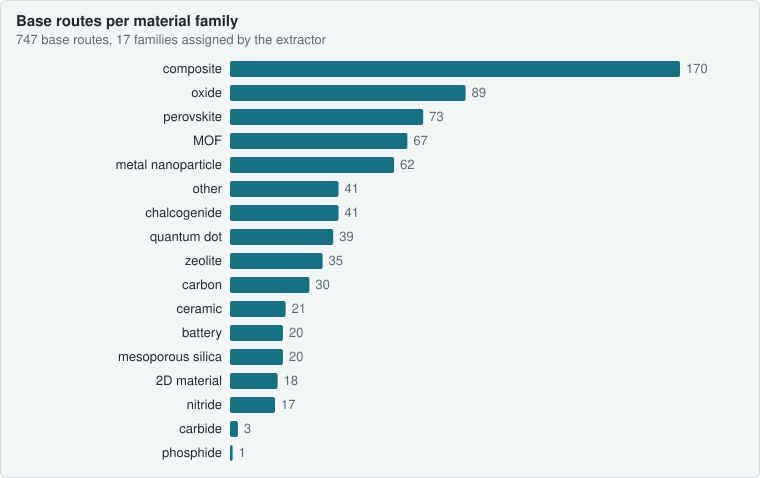
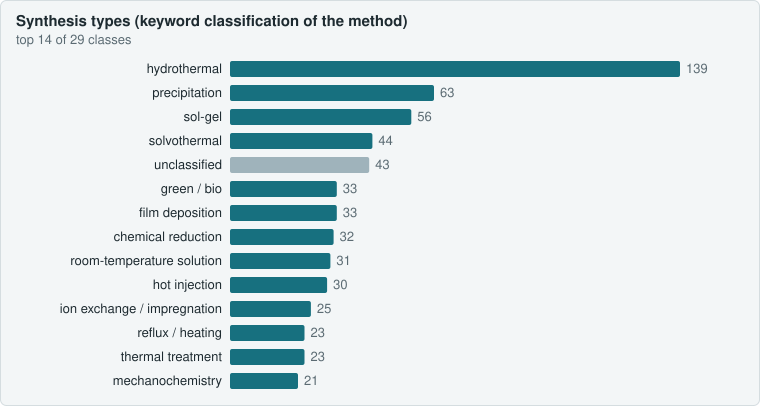
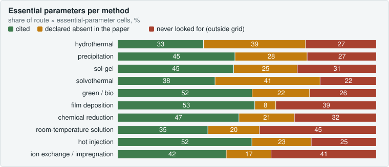
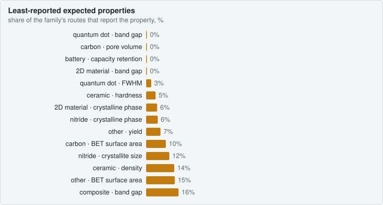
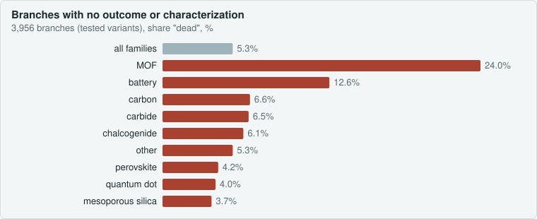
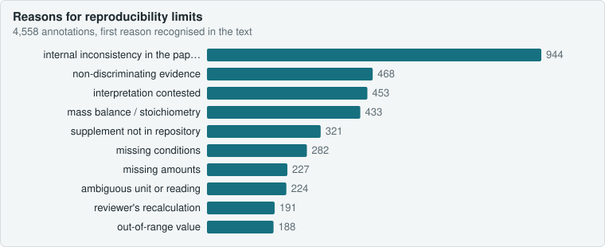
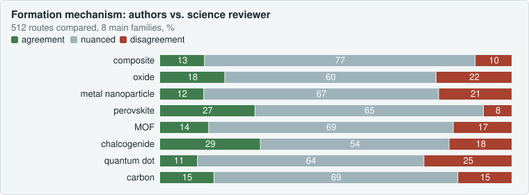
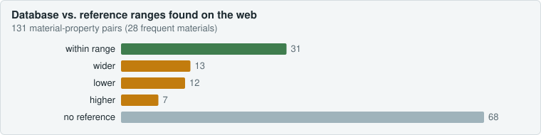
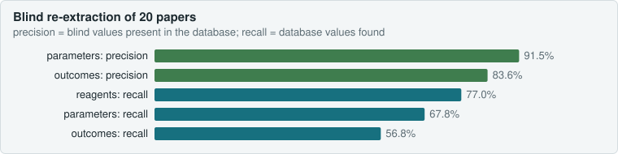

<p align="center"><b>English</b> · <a href="README.fr.md">Français</a> · <a href="#why-this-exists">Presentation</a> · <a href="#analysis">Analysis</a> · <a href="https://terrychauvin.github.io/synthgraph-multi-agent-cloud/#en-presentation">Interactive site (EN/FR tabs)</a></p>

# Materials Synthesis Routes Database

**A verifiable database of materials synthesis protocols, extracted from open-access papers by a multi-agent pipeline. Every value carries the verbatim quote that supports it.**


---

## Why this exists

The synthesis literature is huge but hard to reuse. Conditions are scattered across Methods, Results, tables, captions and supplementary files. Sample series are described in one sentence ("the same procedure was repeated at 150 and 180 °C"). Missing information, such as an unstated annealing atmosphere, is never flagged.

This database answers two questions for each paper:

1. **What exactly does the paper say** about every reagent, step, parameter and result, for every variant the authors compared?
2. **What does it leave out**, and what in it is inconsistent or doubtful for a trained reader?

The goal is that a chemist can **reproduce a material from the database alone** and see **how each synthesis variation tested by the authors changes the outcome**.

## What is inside

| | |
|---|---|
| Publications closed (all passes done) | 500 (500 in the ten audited batches) — target reached |
| Synthesis routes | 5 338 (1 382 base routes, 3 956 branches) |
| Steps / reagents / parameters | 9 546 / 7 714 / 12 731 |
| Measured outcomes | 39 350 |
| Fidelity findings / science verdicts | 4 345 / 2 988 |
| Annotations (interpretations, kept apart from data) | 10 582 |

Figures as of 25 October 2026 (`synthese.db`, read-only queries on closed publications). The target of **500 publications**, built in audited batches of 50, is reached.

Material families covered: MOFs and ZIFs, metal nanoparticles, oxides, perovskites, zeolites and mesoporous silicas, chalcogenides and phosphides, carbons, electrode materials, ceramics, 2D materials, quantum dots.

## How a paper becomes data

Each publication goes through five passes, run by language-model agents with separate roles. No agent checks its own work.

```
 article (Europe PMC, CC licence) + supplementary files + figures
   │
   ▼
 1. Extraction ............ reads the full text, inventories every sample, writes routes,
   │                        branches, quotes, and what is NOT stated
   ▼
 2. Automatic check ....... every quote must be found verbatim in the text,
   │                        every number must appear in its quote
   ▼
 3. Fidelity critique ..... an independent second reader re-reads the article first,
   │                        then compares it with the extraction
 4. Science critique ...... stoichiometry, physical plausibility, consistency with the
   │                        founding literature, sourced web search
   ▼
 5. Corrections ........... applied by a separate agent, decided by the orchestrator,
                            each finding marked corrected or rejected with a reason
```

Every 50 papers, an **audit** re-checks every quote, runs physico-chemical sanity tests, re-reads a sample of values by hand, recomputes the stoichiometry of five routes, cross-compares syntheses of the same material across papers, and checks cited sources.

## Ground rules

- **The quote is the proof.** No value without an exact quote. Nothing invented, inferred or converted on the authors' behalf (SI conversion is stored in a separate column).
- **Absence is data.** What the paper does not state is recorded explicitly (`not_stated`), so a route is never silently "complete".
- **Every comparison counts.** All variants compared by the authors are captured as branches, including failed attempts.
- **Author errors are kept, not fixed.** Inconsistencies in a paper are flagged as reproducibility limits, never repaired in the data.
- **Interpretation is separate from data.** Annotations are typed and stored apart from extracted values.
- **A mistake seen twice becomes a written rule** in the extraction protocol.

## Measured quality (500 papers, 10 batches)

Batches 1 to 4 (200 papers), then one line per later batch.

| Check | Result |
|---|---|
| Quotes found verbatim in the source text | 37 478 / 37 478 (100 %) |
| Values re-read by hand against the paper | 3 593, of which 10 wrong, all in the 10 calibration papers |
| Error rate after calibration | 1 / 3 032 values (0.03 %, 95 % upper bound ≈ 0.16 %) |
| Fidelity findings | 1 770, median 8 per paper; none a mis-copied number since batch 2 |
| Science verdicts on routes | 434 consistent, 604 doubtful, 46 inconsistent, 82 unverifiable |

Batch 5 (papers 201–250, report `audits/palier_005_relecture.md`): 9 581 quotes found verbatim (100 %), 1 112 values re-read by hand with 0 wrong, 428 fidelity findings (median 8 per paper, 4 "wrong"), 0 blocking audit finding.

Batch 6 (papers 251–300, report `audits/palier_006_relecture.md`): 9 680 quotes found verbatim (100 %), 1 887 values re-read by hand with 0 wrong, 419 fidelity findings (median 8 per paper, 3 "wrong"), 0 blocking audit finding.

Batch 7 (papers 301–350, report `audits/palier_007_relecture.md`): 9 238 quotes found verbatim (100 %), 1 032 values re-read by hand with 2 wrong (corrected), 421 fidelity findings (median 8 per paper, 9 "wrong"), 0 blocking audit finding.

Batch 8 (papers 351–400, report `audits/palier_008_relecture.md`): 9 859 quotes found verbatim (100 %), 1 181 values re-read by hand with 1 wrong (corrected), 437 fidelity findings (median 9 per paper, 11 "wrong"), 0 blocking audit finding.

Batch 9 (papers 401–450, report `audits/palier_009_relecture.md`): 9 719 quotes found verbatim (100 %), 1 258 values re-read by hand with 0 wrong, 424 fidelity findings (median 8.5 per paper, 4 "wrong"), 0 blocking audit finding.

Batch 10 (papers 451–500, report `audits/palier_010_relecture.md`): 9 498 quotes found verbatim (100 %), 1 222 values re-read by hand with 3 wrong (corrected), 446 fidelity findings (median 9 per paper, 11 "wrong"), 0 blocking audit finding.

Most "doubtful" verdicts come from the papers themselves, not from the extraction. Typical examples: a reported cobalt content heavier than pure cobalt, a "HeNe laser at 532 nm", an aqueous dispersion "stirred at 350 °C". These are kept as written and flagged.

**Scope.** The database guarantees faithfulness to the source and makes explicit what is missing to reproduce a synthesis. It does not guarantee that a published protocol works.

## Using the database

`synthese.db` is a plain SQLite file. Open it with DB Browser for SQLite, DBeaver, or Python.

Full protocol of one branch, with quotes:

```sql
SELECT step_order, action, parameter, value_num, value_text, unit, quote
FROM v_route_complete
WHERE pmcid = 'PMC0000000' AND branch_label = 'ZnO-180'
ORDER BY step_order;
```

All hydrothermal syntheses between 150 and 200 °C:

```sql
SELECT DISTINCT pmcid, branch_label, material, value_num AS temp_C, quote
FROM v_route_complete
WHERE method LIKE '%hydrothermal%' AND parameter = 'temperature'
  AND unit = '°C' AND value_num BETWEEN 150 AND 200;
```

What a chemist must know before reproducing a route:

```sql
SELECT r.branch_label, a.text FROM annotations a
JOIN papers p ON p.id = a.paper_id LEFT JOIN synthesis_routes r ON r.id = a.route_id
WHERE p.pmcid = 'PMC0000000' AND a.type = 'limite_reproductibilite';
```

Human-readable sheets for each paper are in `fiches/`, and branch graphs in `graphes/`.

## Repository map

| Path | Content |
|---|---|
| `synthese.db` | the database |
| `extractions/` | one JSON per paper, the source of truth for the database |
| `critiques/` | fidelity and science critiques per paper |
| `journaux/` | short decision logs written by each agent |
| `audits/` | batch audit reports, token costs, sources to verify; `audit_contenu.md` and `audit_verification.md` (content and verification audits); `verification/aveugle/` (20 blind re-extractions) |
| `analyses/` | scripts of the content and verification audits, and `build_site.py` (charts, site, README analysis blocks) |
| `docs/` | interactive site (`index.html`, EN/FR tabs), `img/` charts, `audit_contenu/` data and dashboard |
| `RUNBOOK.md`, `CRITIQUE.md`, `PLAUSIBILITE.md` | protocols given to the agents |
| `load.py`, `audit.py`, `critic_load.py` | automatic checks and loading |

<!-- SITE:analysis:begin -->
<a id="analysis"></a>

## Analysis

Two content audits (28 October 2026) examine what the 500 papers actually contain and whether the extraction can be trusted. Everything is reproducible: `python3 -I analyses/audit_contenu.py`, `audit_parametres.py`, `audit_verification.py`, `compare_blind.py`, then `build_site.py` for this page.

| **747** | **29** | **96** | **83%** | **512** | **20** |
|---|---|---|---|---|---|
| material base routes | method classes | canonical properties (from 16,577 names) | of base routes with a limit | mechanisms compared | papers re-extracted blind |


### 1. What the database contains

<p align="center"></p>

<p align="center"></p>

- **Hydrothermal dominates** (18.6% of base routes), then precipitation, sol-gel and solvothermal. Two independent classifications (method keywords, step sequence) agree on **68.8%**.
- The 16,577 free property names are mapped to **96 canonical properties** by a regex table; **9.1% of values** stay unclassified (names too specific). A closed vocabulary is needed before any statistical use.


### 2. Common and essential parameters

<p align="center"></p>

- **Temperature and duration are the only universal parameters** (90–100% of routes of the main methods). Beyond that, two routes of the same method share only 25–45% of their parameter types (Jaccard similarity 0.19–0.43).
- **Papers are the first source of gaps.** For autoclave methods, 39% of essential parameters are not given by the paper (and the extractor said so); fill fraction is cited in 1–5% of routes, heating and cooling rates in under 12%.
- **The extraction has blind spots**: cooling rate, gas flow, cycle repeats, power and fill fraction are not in the reproducibility grid, so they are neither cited nor declared absent.
- Precursor amounts, by contrast, are given for 87% (hydrothermal) to 97% (green routes) of precursors and declared absent when missing: no silent gaps.


### 3. Coverage gaps

<p align="center"></p>

- **132 family × method cells out of 175** hold fewer than 5 routes: beyond hydrothermal and sol-gel, each method is represented by a handful of routes per family (electrochemistry: 4 routes in total).
- **43 expected family-property pairs** are covered below 30%: band gap and quantum yield of perovskites, BET area of carbons, capacity retention of batteries, density and hardness of ceramics.
- Under-represented families: carbides (3 routes), phosphides (1), nitrides (17), 2D materials (18). Missing or buried in "other": polymers, glasses, alloys, COFs, solid electrolytes, thermoelectrics.


### 4. Data quality

<p align="center"></p>

- **Branches**: 5.3% with neither outcome nor characterization, but 24% among MOFs (condition series for which the paper reports a single global result).
- **Nominal stoichiometry**: of 60 checkable routes, 24 match the product formula within 10%; large gaps are intended excesses or precursors supplied by an intermediate route, not errors.
- **8 out-of-range values**, all copied from the papers (quantum yields of 112–241% for carbon dots, measured against a standard).
- **Normalization**: 682 parameter names for 27 types; 71% of numeric parameters have an SI value (temperature, duration, ramp at 99%; never volumes, concentrations, speeds: a `load.py` limit).
- **Variation → effect**: 61% of 3,064 numeric variations have a property measured on both sides; 693 series of 3+ points, 56% monotonic. A temperature change shifts size and texture properties by 40–50% (median), a reagent change shifts optical properties by under 10%.


### 5. Reproducibility limits and mechanisms

<p align="center"></p>

<p align="center"></p>

- **83% of base routes** carry at least one limit; the first cause is internal inconsistency in the paper (21%), ahead of non-discriminating evidence (10%), contested interpretation (10%) and impossible mass balances (9.5%).
- Over 512 routes, the authors' mechanism and the science reviewer's are in **agreement for 83**, **nuanced for 346** (including 106 papers that describe no mechanism) and in **disagreement for 83**; **25** mechanisms are contradicted by the extracted conditions (reduction without a reductant, AgCl precipitating before any reduction…).
- Foundational works most often missing though they ground the method: Iravani 2011 (29), Cundy & Cox 2003 (16), Essner et al. 2018 (15).


### 6. Comparison with the literature

<p align="center"></p>

- Of 131 material-property pairs, 31 fall within the published range. Clear deviations: SnS band gap (median 2.81 eV vs. 1.07–1.40 eV bulk), CdS photoluminescence (580 nm vs. 490–505 nm: trap emission), "mesoporous" silicas (BET 274 vs. 400–1,137 m²/g), ZIF-8 micropore volume (0.15 vs. 0.52–0.62 cm³/g).
- Structured databases (CoRE MOF, IZA, Materials Project) are not reachable from the execution environment; ranges come from the web, with the URL actually consulted.


### 7. Verification by blind re-extraction

<p align="center"></p>

- 20 randomly drawn papers were re-extracted by an agent that saw neither the database extraction nor the critiques: 167 of 172 routes matched. **91.5% of parameters and 83.6% of outcomes** found blind are in the database, with **0 conflict** on unambiguous values.
- The lower recall (68% of parameters, 57% of outcomes) measures what the critiques add: the database holds about 30% more parameters and 40% more outcomes than a single extraction. Remaining disagreements are attributions of a value to another sample or route.


### Full reports

- [audits/audit_contenu.md](https://github.com/TerryChauvin/synthgraph-multi-agent-cloud/blob/main/audits/audit_contenu.md) — synthesis types, properties, conditions, gaps, quality, mechanisms, references
- [audits/audit_verification.md](https://github.com/TerryChauvin/synthgraph-multi-agent-cloud/blob/main/audits/audit_verification.md) — parameters per method and seven verification checks
- [audits/palier_010_relecture.md](https://github.com/TerryChauvin/synthgraph-multi-agent-cloud/blob/main/audits/palier_010_relecture.md) — latest batch audit

<!-- SITE:analysis:end -->

## Full methodology

The complete method, written as a "Materials and Methods" section with all measurements, limits and threats to validity, is in French: **[README.fr.md](README.fr.md)**.

## Licence and sources

Source articles are open access under Creative Commons licences (CC BY, CC BY-NC, CC BY-NC-ND, CC BY-NC-SA). Some of them are non-commercial or no-derivatives. Each record keeps its paper's licence and URL, and the full text of those articles in `corpus/` remains under its original licence. Reuse of the data must respect each paper's licence.
